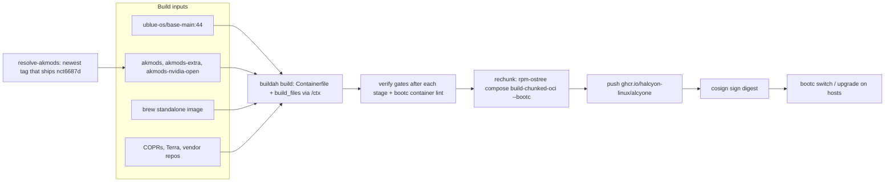

# Halcyon — `alcyone`

A signed, bootc-native Fedora Atomic image for an NVIDIA gaming workstation. Built from a single `Containerfile` on top of Universal Blue `base-main`, with the OGC gaming kernel, the NVIDIA **open** kernel modules, and a Hyprland + Noctalia desktop.

|                   |                                                                            |
| ----------------- | -------------------------------------------------------------------------- |
| **Image**         | `ghcr.io/halcyon-linux/alcyone` (tags: `stable`, `latest`, `YYYYMMDD`)     |
| **Base**          | `ghcr.io/ublue-os/base-main:44` (Fedora 44, x86_64)                        |
| **Kernel**        | OGC (Open Gaming Collective) kernel from `ublue-os/akmods`, version-locked |
| **GPU**           | NVIDIA open modules (`akmods-nvidia-open`), multilib                       |
| **Extra kmod**    | `nct6687d` only (NCT6687 sensors, MSI Z790-P target)                       |
| **Desktop**       | SDDM + Hyprland (git) + Noctalia shell                                     |
| **Update stack**  | bootc / rpm-ostree, `uupd`, greenboot                                      |
| **Signing**       | cosign key pair; the public key is [`cosign.pub`](cosign.pub)              |
| **Source branch** | `containerfile` (default and release branch)                               |
| **License**       | Apache-2.0                                                                 |

## Contents

1. [Quickstart (TL;DR)](#quickstart-tldr)
2. [Pull and verify with cosign](#pull-and-verify-with-cosign)
3. [Install, update, roll back](#install-update-roll-back)
4. [Architecture](#architecture)
5. [Build locally](#build-locally)
6. [CI/CD](#cicd)
7. [Using the system](#using-the-system)
8. [Dotfiles with chezmoi](#dotfiles-with-chezmoi)
9. [Build-time verification gates](#build-time-verification-gates)
10. [Security and supply-chain posture](#security-and-supply-chain-posture)
11. [Design decisions](#design-decisions)
12. [Roadmap](#roadmap)
13. [Repository layout](#repository-layout)
14. [Contributing](#contributing)
15. [Upstream and license](#upstream-and-license)

---

## Quickstart (TL;DR)

```bash
curl -fsSLO https://raw.githubusercontent.com/halcyon-linux/base-image/containerfile/cosign.pub
IMAGE=ghcr.io/halcyon-linux/alcyone
DIGEST=$(skopeo inspect --format '{{.Digest}}' docker://$IMAGE:stable)
cosign verify --key cosign.pub "$IMAGE@$DIGEST" && sudo bootc switch "$IMAGE@$DIGEST" && sudo systemctl reboot
```

Full procedure, fingerprint check, troubleshooting, and unverified/development rebases below.

---

## Pull and verify with cosign

### How signing works here

- CI pushes the image, then signs the **manifest digest** with a self-managed ECDSA P-256 key (`SIGNING_SECRET` in GitHub Actions).
- `stable`, `latest` and the dated tag all point at the same digest at push time, so one signature covers all three.
- Signing uses `cosign sign --key … --new-bundle-format=false --use-signing-config=false`. That produces a **legacy-format** signature stored in the registry next to the image (tag `sha256-<digest>.sig`).
- `cosign.pub` in this repo is the verification key.

### Step 1 — Check your tools

```bash
command -v cosign skopeo curl openssl jq
cosign version
```

- The `alcyone` image itself ships `cosign` (inherited from `base-main`).
- On other hosts, install `cosign` from <https://docs.sigstore.dev/cosign/system_config/installation/>.
- On Atomic hosts where you cannot install packages, run the verification inside a Toolbx or Distrobox container.

### Step 2 — Obtain `cosign.pub`

Either download it (as in the quickstart) or use a checkout:

```bash
git clone --branch containerfile https://github.com/halcyon-linux/base-image.git
cd base-image
cat cosign.pub
```

Expected contents:

```text
-----BEGIN PUBLIC KEY-----
MFkwEwYHKoZIzj0CAQYIKoZIzj0DAQcDQgAErR+XTgkFFRqVcpRrfuLOiZqYl0XD
i7XfYkkUm+i1cDqGVRA2jV6As4M2mIkIgkYbQuHeLqqkXH5/Zc5vUQLBvg==
-----END PUBLIC KEY-----
```

### Step 3 — Check the key fingerprint

```bash
openssl pkey -pubin -in cosign.pub -outform DER | sha256sum
# 9410658270bd845ed529f5f2a2f6a1a62bc5c28a49456b6cc4d97d57b1dca240  -
```

If the hash differs, stop: the key was rotated or the file was tampered with. Compare against a second source (a different clone, the repository's git history) before trusting it. After a deliberate key rotation, this fingerprint must be updated in this README.

### Step 4 — Resolve the tag to a digest

Verifying a digest rather than a tag avoids a race where the tag moves between verification and pull.

```bash
IMAGE=ghcr.io/halcyon-linux/alcyone
DIGEST=$(skopeo inspect --format '{{.Digest}}' docker://$IMAGE:stable)
echo "$DIGEST"      # sha256:…
```

### Step 5 — Verify the signature

```bash
cosign verify --key cosign.pub "$IMAGE@$DIGEST"
```

Success means exit code `0`, a report that the cosign claims were validated and the signatures verified against the supplied public key, and JSON whose `critical.image.docker-manifest-digest` equals `$DIGEST`. To check that field when scripting:

```bash
cosign verify --key cosign.pub "$IMAGE@$DIGEST" \
  | jq -e --arg d "$DIGEST" '.[0].critical.image["docker-manifest-digest"] == $d'
```

A non-zero exit means **do not deploy**.

### Step 6 — Pull and inspect (optional)

```bash
skopeo inspect "docker://$IMAGE@$DIGEST" | jq '.Labels'
podman pull "$IMAGE@$DIGEST"
```

Useful labels: `org.opencontainers.image.version`, `org.opencontainers.image.revision` (git SHA), `org.opencontainers.image.created`, `ostree.linux` (kernel).

### Step 7 — Deploy

Pin to exactly what you verified (no automatic updates until you switch back to a tag):

```bash
sudo bootc switch "$IMAGE@$DIGEST"
```

Or track the stable channel (the tag may have advanced since verification, so re-run Steps 4–5 immediately before):

```bash
sudo bootc switch "$IMAGE:stable"
```

Reboot, then confirm:

```bash
sudo systemctl reboot
# after reboot
bootc status
jq . /usr/share/ublue-os/image-info.json
```

### Troubleshooting

| Symptom                            | Likely cause and action                                                                                                                                                                          |
| ---------------------------------- | ------------------------------------------------------------------------------------------------------------------------------------------------------------------------------------------------ |
| `no signatures found`              | Your cosign version may look for the new bundle format first. CI signs with `--new-bundle-format=false`; retry with `cosign verify --key cosign.pub --new-bundle-format=false "$IMAGE@$DIGEST"`. |
| Transparency-log errors            | The signing flags are in `.github/workflows/build.yml`. Check how the signature was recorded before relaxing tlog checks (`--insecure-ignore-tlog`), and only do so deliberately.                |
| `invalid signature` / fingerprint mismatch | Wrong key or rotated key. Re-check Step 3. Treat as a security event until explained.                                                                                                            |

> Registry errors (`denied`, `unauthorized`, rate limiting): retry later or authenticate with `podman login ghcr.io` / `skopeo login ghcr.io`.  
> Signature verifies but deployed a different image: always verify the same `@sha256:` digest you deploy.

### Enforcing the signature on the host (optional)

`bootc switch` and `rpm-ostree rebase ostree-unverified-registry:` do not enforce a container signature policy unless you ask them to. The image's baked reference is `ostree-image-signed:docker://ghcr.io/halcyon-linux/alcyone`, but **this repository does not ship a `policy.json` or `registries.d` entry for `ghcr.io/halcyon-linux`**, so enforcement depends on your host's `/etc/containers` configuration.

For the recommended `policy.json` hardening (reject unsigned by default, allow only this key), see [CVE-2026-16487 mitigation](#cve-2026-16487-mitigation-mutable-tags-and-automatic-updates).

To enforce signatures without the full hardening, add the registries.d entry and a minimal policy rule:

```bash
sudo install -Dm0644 cosign.pub /etc/pki/containers/halcyon-linux.pub

sudo tee /etc/containers/registries.d/halcyon-linux.yaml >/dev/null <<'EOF'
docker:
  ghcr.io/halcyon-linux:
    use-sigstore-attachments: true
EOF
```

Add this entry under `transports.docker` in `/etc/containers/policy.json`:

```json
"ghcr.io/halcyon-linux/alcyone": [
  {
    "type": "sigstoreSigned",
    "keyPath": "/etc/pki/containers/halcyon-linux.pub",
    "signedIdentity": { "type": "matchRepository" }
  }
]
```

Then:

```bash
sudo bootc switch --enforce-container-sigpolicy ghcr.io/halcyon-linux/alcyone:stable
# rpm-ostree equivalent
sudo rpm-ostree rebase ostree-image-signed:docker://ghcr.io/halcyon-linux/alcyone:stable
```

> `ujust verify-image` only rewrites an `ostree-unverified-registry:` deployment reference to `ostree-image-signed:docker://…` and rebases to it. It does **not** run cosign. Use the steps above for cryptographic verification.

---

## Install, update, roll back

### Switch an existing system

After verifying (see [Pull and verify](#pull-and-verify-with-cosign)):

```bash
# bootc hosts — pin to digest for no auto-updates, or :stable to track
sudo bootc switch ghcr.io/halcyon-linux/alcyone@sha256:<DIGEST>
# sudo bootc switch ghcr.io/halcyon-linux/alcyone:stable

# rpm-ostree hosts (unverified transport; verify with cosign first)
sudo rpm-ostree rebase ostree-unverified-registry:ghcr.io/halcyon-linux/alcyone:stable
```

This repository does not build installer ISOs or disk images. For a fresh machine, install any Fedora Atomic / bootc-capable system and switch to this image, or generate a disk image externally with `bootc-image-builder`.

### Updates

Updates are staged, then applied on reboot.

```bash
ujust update           # alias: ujust upgrade — runs uupd-update
sudo bootc upgrade     # manual equivalent for the OS image
bootc status           # booted / staged / rollback deployments
```

- `uupd.timer` is enabled. `rpm-ostreed-automatic.timer` is disabled and `AutomaticUpdatePolicy=none`, so `uupd` is the only automatic updater.
- Recent changes: `ujust changelogs` opens the commit history of the `containerfile` branch.

### Updating to an unverified / development image (one-time)

If you need to switch to `:latest` or a local build **before** the signature is published (e.g., testing a PR build), use the unverified transport. This skips container signature policy checks for that rebase only; your existing verified deployment remains available for rollback.

```bash
# Rebase to :latest via unverified transport (skips signature verification)
sudo rpm-ostree rebase ostree-unverified-registry:ghcr.io/halcyon-linux/alcyone:latest

# Or rebase to a local build
sudo rpm-ostree rebase ostree-unverified-registry:localhost/alcyone-build:44-containerfile

# Reboot to activate
sudo systemctl reboot
```

> **Note:** `bootc switch` has no `--unverified` flag. Use `rpm-ostree rebase ostree-unverified-registry:…` for the one-time switch; `bootc upgrade`/`bootc rollback` work normally afterward.

### CVE-2026-16487 mitigation (mutable tags and automatic updates)

A vulnerability (CVE-2026-16487, published 2026-10-19) allows automatic updates of mutable tags (`:latest`, `:stable`) to apply unsigned content under the default containers policy. The image's `AutomaticUpdatePolicy=none` and disabled `rpm-ostreed-automatic.timer` mitigate this, but for defense-in-depth:

```bash
# 1. Pin bootc updates to digests (recommended)
#    Instead of: sudo bootc switch ghcr.io/halcyon-linux/alcyone:latest
#    Use: sudo bootc switch ghcr.io/halcyon-linux/alcyone@sha256:<DIGEST>

# 2. Harden /etc/containers/policy.json to reject unsigned by default
#    (merge into your existing policy.json; do not overwrite)
sudo tee /etc/containers/policy.json <<'EOF'
{
  "default": [{"type": "reject"}],
  "transports": {
    "docker": {
      "ghcr.io/halcyon-linux": [{
        "type": "sigstoreSigned",
        "keyPath": "/etc/pki/containers/halcyon-linux.pub",
        "signedIdentity": { "type": "matchRepository" }
      }]
    }
  }
}
EOF

# Install the verification key (from this repo's cosign.pub)
sudo install -Dm0644 cosign.pub /etc/pki/containers/halcyon-linux.pub

# 3. Disable automatic updates timer (already done in this image)
systemctl disable --now bootc-fetch-apply-updates.timer 2>/dev/null || true
```

> **Reference:** CVE-2026-16487 workaround — "Pin bootc updates to image digests, or configure `/etc/containers/policy.json` to reject unsigned content by default and allow only explicitly trusted signed scopes. Until policy is hardened, disable automatic updates (`bootc-fetch-apply-updates.timer`)."

### Rollback

```bash
sudo bootc rollback    # then reboot
brh                    # guided rollback / rebase helper
```

GRUB shows its menu for 10 seconds (`GRUB_TIMEOUT=10`, `GRUB_TIMEOUT_STYLE=menu`), so you can boot an older deployment or edit kernel arguments. `greenboot` health-check and rollback-trigger services are enabled.

---

## Architecture

### bootc model

The whole OS is a single OCI image. Nothing is installed package-by-package on the live host:

- `/usr` is read-only and comes entirely from the image.
- `/etc` holds image defaults plus local overrides; `/var` is machine-local state.
- An update pulls a new image into a staged deployment; the previous deployment remains for rollback.
- `bootc container lint` is the last instruction in the `Containerfile` and gates every build.

### Pipeline



### Kernel and driver selection

`just_scripts/resolve-akmods` walks published `akmods-extra` tags newest-first (`ogc-44-<kernel-version>`) and picks the first tag where:

1. `akmods`, `akmods-extra` **and** `akmods-nvidia-open` are all published for that tag, and
2. the `akmods-extra` payload actually contains the `nct6687d` kmod.

If no tag qualifies, the build refuses to run. CI and `just build` both use this, so the Containerfile carries no hardcoded kernel version. A bare `podman build` falls back to the floating tag `ogc-44-x86_64`.

The kernel swap (`build_files/kernel/install-kernel-akmods`) removes the stock kernel, installs the OGC RPMs, adds a `dnf5 versionlock`, and installs only `nct6687d` from the extra kmods. NVIDIA modules are installed from prebuilt RPMs via `nvidia-install.sh` (`MULTILIB=1`); `nvidia-gpu-firmware` (nouveau) is removed first.

### Build contract (`/ctx`)

`build_files/` is exposed to the build as a scratch stage (`ctx`) and bind-mounted at `/ctx`, so scripts never land in image layers. Package-installing `RUN` steps typically:

- mount `/var/cache` and `/var/log` caches and a tmpfs `/tmp`,
- call one script, then `/ctx/finalization/verify <stage>`, then `/ctx/shared/cleanup`,
- mount the `GITHUB_TOKEN` secret where a GitHub download or the NVIDIA installer needs it.

`build_files/shared/dnf5` is a build-only retry shim (up to 5 retries, 60 s apart) installed before the first dnf transaction to survive upstream metadata republishing. It is removed before the final lint.

### Build stages (in order)

| #   | Stage                                                                                                              | Script                                                                | Gate                                              |
| --- | ------------------------------------------------------------------------------------------------------------------ | --------------------------------------------------------------------- | ------------------------------------------------- |
| 1   | Shared Bazzite config → `/`                                                                                        | `COPY system_files/desktop/`                                          | —                                                 |
| 2   | dnf5 retry shim                                                                                                    | `shared/dnf5`                                                         | `tests/test-dnf5-retry.sh` (CI)                   |
| 3   | Homebrew standalone files                                                                                          | `packages/install-brew-files`                                         | `verify brew`                                     |
| 4   | OGC kernel + `nct6687d`                                                                                            | `kernel/install-kernel-akmods`                                        | `verify kernel`                                   |
| 5   | Repositories, priorities, excludes                                                                                 | `packages/setup-repositories`                                         | `verify repos`                                    |
| 6   | CLI tools COPR                                                                                                     | `packages/install-cli-tools`                                          | `verify cli-tools`                                |
| 7   | Python utilities COPR                                                                                              | `packages/install-utils`                                              | `verify utils`                                    |
| 8   | Remove superseded packages                                                                                         | `packages/global-remove`                                              | `verify removals`                                 |
| 9   | Common packages                                                                                                    | `packages/install-common-packages`                                    | `verify common-packages`                          |
| 10  | Gaming stack                                                                                                       | `packages/install-gaming-stack`                                       | `verify gaming`                                   |
| 11  | Fonts                                                                                                              | `packages/install-fonts`                                              | `verify fonts`                                    |
| 12  | Hyprland / Noctalia                                                                                                | `packages/install-base-pkgs`                                          | `verify base-pkgs`                                |
| 13  | Applications, browsers, `bees`                                                                                     | `packages/install-applications`                                       | `verify applications`                             |
| 14  | TeX Live (+ baked formats)                                                                                         | `packages/install-texlive-packages` → `packages/bake-texlive-formats` | `verify texlive-packages`                         |
| 15  | Nix                                                                                                                | `packages/install-nix`                                                | `verify nix`                                      |
| 16  | `ujust-picker`                                                                                                     | `packages/install-ujust-picker`                                       | `verify picker`                                   |
| 17  | Media automount                                                                                                    | `packages/install-media-automount`                                    | `verify media`                                    |
| 18  | Overrides, then desktop integration, justfiles, services, GRUB, integration files, image-info, initramfs, finalize | `system/*`, `just/*`, `finalization/*`, `kernel/build-initramfs`      | `verify desktop-integration` … `verify finalize`  |
| 19  | NVIDIA: config, driver, system policy, finalize; then image-info, initramfs, finalize again                        | `nvidia/*`, `system/configure-system-policy`                          | `verify nvidia-config` … `verify nvidia-finalize` |
| 20  | Final assertions and lint                                                                                          | —                                                                     | `verify final`, `bootc container lint`            |

Metadata, initramfs and finalization run twice on purpose: the second pass must include the NVIDIA modules.

### Package sources and repository lifecycle

| Source                                                                                                               | Used for                                                                                                | Lifecycle                                                                                   |
| -------------------------------------------------------------------------------------------------------------------- | ------------------------------------------------------------------------------------------------------- | ------------------------------------------------------------------------------------------- |
| `ublue-os/base-main:44`                                                                                              | Base OS                                                                                                 | Image base                                                                                  |
| `ublue-os/akmods*` images                                                                                            | Kernel, kmods, NVIDIA RPMs                                                                              | Build inputs only                                                                           |
| `ublue-os/{bazzite,bazzite-multilib,staging,packages}` COPRs                                                         | Patched bluez and Xwayland (`bazzite-multilib`), Bazaar and media-automount (`packages`), helpers       | Enabled for the build, **disabled in the shipped image**                                    |
| Terra (`terra`, `terra-extras`, `terra-mesa`)                                                                        | gamescope, MangoHud, wireplumber, mesa bits                                                             | Priority 1 with excludes; disabled in the shipped image                                     |
| `aahsnr-work/cli-tools`, `python-packages`, `gaming`, `fonts`, `base-pkgs`, `applications`, `texlive-packages` COPRs | The Halcyon package sets                                                                                | Each enabled at `priority=1` inside its own script, then disabled before the script returns |
| Vendor repos (Tailscale, GitHub CLI, VS Code, VSCodium, Brave, Chrome, Edge, Vivaldi)                                | Their packages                                                                                          | Disabled in the shipped image by `configure-system-policy`                                  |
| GitHub releases and raw files via `ghcurl`                                                                           | `cicpoffs`, `extest`, `ujust-picker`, winetricks, DXVK example config, Distrobox template, bash-preexec | Downloaded at build time                                                                    |

Version-locked packages: kernel set, `bluez*`, `xorg-x11-server-Xwayland`, core `mesa-*`, `NetworkManager*`.

### What the image ships

- **Desktop**: SDDM (default target `graphical.target`), Hyprland + Noctalia, Bazaar software center (Flatpak remote declared; no Flatpak apps pre-installed).
- **Shell and CLI**: zsh as the default login shell (fish and `greetd` removed); a pinentry dispatcher (GUI when a graphical session exists, curses/tty otherwise); a large CLI toolset (`bat`, `eza`, `fzf`, `ripgrep`, `atuin`, `starship`, `zellij`, `yazi`, `lazygit`, `uv`, `pixi`, …).
- **Gaming**: Steam (no autostart), Lutris, gamescope, MangoHud, vkBasalt, umu-launcher, ProtonPlus, Heroic, winetricks, `scx` schedulers, `ds-inhibit`, `input-remapper`. Handheld-specific packages are removed; Waydroid is intentionally absent.
- **System**: Btrfs tooling (`btrfs-assistant`, `snapper`, `compsize`), `bees` deduplication (per-filesystem timers via `ujust configure-beesd`), Cockpit modules (`cockpit-ws` is not installed; a Quadlet is toggled by `ujust cockpit`), libvirt/QEMU/virt-manager, Tailscale (installed; `tailscaled` disabled by default), greenboot, `fail2ban`, `lynis`.
- **Package ecosystems**: Homebrew (standalone), Nix (`nix`, `nix-daemon`, `/nix` mount units for the immutable root), Distrobox/Toolbx, Flatpak runtime.
- **Apps and toolchains**: Firefox, Chrome, Brave, Edge, Vivaldi, VS Code, VSCodium, Neovim, Emacs, Obsidian, OnlyOffice, Bitwarden; Go, Rust (`cargo`), Node 22, CMake, Ninja; TeX Live with formats baked at build time.
- **Runtime tuning**: zram, sysctl drop-ins for gaming/networking/inotify, TuneD profiles (`*-bazzite`), an optional 1 GiB hugepage mount, VFIO dracut config, `ntsync` module load.
- **Rechunked** with `rpm-ostree compose build-chunked-oci --bootc --max-layers 127` for efficient updates.

### Repository policy for payloads

- Static content lives under `/usr`; `/etc` carries defaults and overrides; `finalize` strips `/var`, so nothing static may live there.
- `system_files/overrides/` is copied **after** package installation so intentional overrides win.
- Commands that upstream shipped from `usr/bin` now come from RPMs (`brh`, `bruh`, `crh`, `gameclass`, `ublue-motd`, `uupd-update`, …). `system_files/desktop/usr/bin` intentionally does not exist.

---

## Build locally

Prerequisites: Linux with `podman` (or `podman-remote`), `just`, `git`, `skopeo`, `jq`, outbound network access to `ghcr.io`, Copr and GitHub, and plenty of free disk. CI frees runner disk space before building.

```bash
just                # list recipes
just build          # build alcyone (the only supported target)
just run            # run a shell in the built image (builds first if missing)
just list-images    # list localhost/alcyone*-build images
just clean-images   # remove them
just just-check     # check .just and Justfile formatting (uses `just --unstable`)
```

- `just build` resolves the akmods tag with `resolve-akmods`, then runs `podman build` with the same build args CI uses. The result is tagged `localhost/alcyone-build:44-<git-branch>`.
- Requests for any target other than `alcyone` (or `containerfile`) are rejected by `just_scripts/get-defaults`.
- Overrides: `CONTAINER_MGR` (`podman` or `podman-remote`), `KERNEL_FLAVOR`, `REQUIRED_KMOD`, `AKMODS_TAG`, `KERNEL_VERSION`.
- Local images are **not rechunked and not signed**.
- `just build` does not forward `GITHUB_TOKEN`; GitHub downloads then run unauthenticated and may hit rate limits.

Equivalent manual build (mirrors CI, and forwards the token):

```bash
AKMODS_TAG=$(just_scripts/resolve-akmods ogc 44 x86_64 nct6687d)
KERNEL_VERSION=${AKMODS_TAG#ogc-44-}

podman build -f Containerfile --target alcyone \
  --build-arg FEDORA_VERSION=44 \
  --build-arg KERNEL_FLAVOR=ogc \
  --build-arg AKMODS_TAG="$AKMODS_TAG" \
  --build-arg KERNEL_VERSION="$KERNEL_VERSION" \
  --secret id=GITHUB_TOKEN,env=GITHUB_TOKEN \
  -t localhost/alcyone:dev .
```

`GITHUB_TOKEN` is optional; `ghcurl` falls back to unauthenticated requests when it is absent.

Fast checks without a full build:

```bash
bash tests/test-dnf5-retry.sh                                  # dnf5 retry shim self-test
for f in build_files/*/* just_scripts/* tests/*.sh; do bash -n "$f"; done
```

---

## CI/CD

### `.github/workflows/build.yml` — build alcyone

| Item            | Value                                                                                               |
| --------------- | --------------------------------------------------------------------------------------------------- |
| Triggers        | Daily `40 4 * * *` UTC; push to `containerfile` (ignoring `**.md`, `**.txt`); manual dispatch       |
| Runner / limits | `ubuntu-26.04`, 90-minute timeout, free-disk-space step first                                       |
| Permissions     | `permissions: {}` at top level; the job gets `contents: read`, `packages: write`, `id-token: write` |
| Concurrency     | Per trigger; pushes cancel older pushes, manual dispatches are never cancelled by a push            |
| Action pinning  | Every action pinned to a full commit SHA                                                            |

Steps: checkout → `just` syntax check → dnf5 shim test → resolve akmods tag → pull base and akmods images and read the upstream version → `buildah build --target alcyone --build-arg-file build_args.txt --secret id=GITHUB_TOKEN` → compute OCI labels (including `ostree.bootable=true` and `ostree.linux`) → rechunk → log in to GHCR → **push** (`:stable`, then `:latest` and `:YYYYMMDD` copied by digest, with retry) → install cosign `v3.1.3` → **sign the digest**.

Publishing and signing run **only** when `github.ref == refs/heads/containerfile`, so a manual dispatch on another ref or tag cannot overwrite `stable` or `latest`.

Secrets: `SIGNING_SECRET` (cosign private key) and the automatic `GITHUB_TOKEN`.

### `.github/workflows/clean.yml` — cleanup

Sundays 00:15 UTC (and manual): deletes `alcyone` package versions older than 90 days, keeping at least 7 tagged and 7 untagged, and removes orphaned images.

### Other automation config

- `.github/renovate.json5`: `config:best-practices`; pin and pinDigest updates auto-merge; digest updates for container dependencies in workflow files are disabled.
- `.github/pull.yml`: upstream-sync configuration (merge from `ublue-os:main`; its base branch setting is `main`).

---

## Using the system

### `ujust` recipes

Run `ujust` for the full list. Commonly used:

| Recipe | Purpose |
| ------ | ------- |
| `update` / `upgrade` | Update OS image and apps via `uupd` |
| `changelogs` | Open recent image changes |
| `verify-image` | Rebase unverified ref to `ostree-image-signed:` form |
| `dotfiles` | chezmoi menu: `status`, `sync`, `diff`, `edit` |
| `configure-grub`, `regenerate-grub`, `grub-timeout` | GRUB maintenance |
| `configure-snapshots`, `configure-beesd` | Btrfs snapshots and deduplication |
| `setup-virtualization` | Repair or disable libvirt/KVM |
| `cockpit` | Toggle Cockpit container (Quadlet) |
| `tailscale` | Manage Tailscale |
| `update-nvidia-runtime` | Sync NVIDIA Flatpak runtime |

### Software installation guidance

Keep the image clean: prefer Homebrew, Flatpak, Nix, Distrobox or containers over layering RPMs. System Flatpaks live in `/var/lib/flatpak`; the image declares only Flathub and ships zero Flatpak apps.

### Useful runtime facts

- Root on Btrfs with zstd + `bees` deduplication; use `compsize` to measure savings.
- Kernel and NVIDIA driver built against the same akmods tag; they move together.
- Steam does not autostart on first login.

### Dotfiles with chezmoi

The image installs `chezmoi` and wires it via systemd user units to [`aahsnr-configs/dotfiles`](https://github.com/aahsnr-configs/dotfiles). Upstream docs: <https://chezmoi.io>.

**What the image sets up**

| Component | When it runs | What it does |
| --- | --- | --- |
| `chezmoi-init.service` | At login, if `~/.local/share/chezmoi/.git` missing | `chezmoi init --apply --force aahsnr-configs/dotfiles` (retries up to 5×/5 min) |
| `chezmoi-update.timer` | 5 min after boot, then daily | Triggers the update service |
| `chezmoi-update.service` | By the timer | `chezmoi update --no-tty --force` (pull + apply) |
| `ujust dotfiles` | Manual | Menu: `status` / `sync` / `diff` / `edit` |

Units live in `/usr/lib/systemd/user/` (read-only, replaced on image updates). They skip system accounts and the `sddm` greeter (`ConditionUser=!@system`, `ConditionUser=!sddm`).

The dotfiles repo is public; clones/pulls use anonymous HTTPS. After init, the service sets a `pushInsteadOf` rule rewriting only **pushes** to SSH, and `core.sshCommand` pinned to `~/.ssh/id_ed25519_aahsnr_configs`. Manual pushes need that key. `/etc/ssh/ssh_config.d/10-halcyon-github.conf` uses the same key for `github.com`.

```bash
systemctl --user list-timers chezmoi-update.timer     # next scheduled update
journalctl --user -u chezmoi-update.service -e        # last update's log
```

**Daily operations**

| Command | Effect |
| --- | --- |
| `chezmoi status` / `diff` | What `apply` would change |
| `chezmoi apply --force` | Make `$HOME` match the source |
| `chezmoi add ~/.zshrc` | Copy a `$HOME` file into the source |
| `chezmoi re-add` | Re-snapshot every managed file that differs |
| `chezmoi edit [--apply] ~/.zshrc` | Edit the source copy |
| `chezmoi update --force` | `git pull --autostash --rebase`, then apply |
| `chezmoi forget` / `remove` | Stop managing / delete source and target |
| `chezmoi managed` / `unmanaged` / `doctor` / `cd` / `source-path` | Inspection helpers |
| `chezmoi git -- <args>` | Run git in the source dir from anywhere |

**Source naming**

| Source name | Target |
| --- | --- |
| `dot_zshrc` | `~/.zshrc` |
| `private_dot_ssh/` | `~/.ssh` with group/world bits cleared |
| `exact_dot_gnupg/` | `~/.gnupg`, also removes untracked files |
| `create_dot_zprofile` | Created only if missing |
| `run_once_*.sh` / `run_onchange_*.sh` | Scripts: once per content / on content change |
| `*.tmpl` | Rendered as a template |

**Gotchas**

- The daily timer **silently reverts** `$HOME` edits not `add`ed back. Prefer `chezmoi edit` + `chezmoi apply --force`.
- First apply overwrites managed files that differ; always `chezmoi diff` first on an existing machine.
- Update conflicts = git conflicts in the source dir: `chezmoi cd`, resolve, commit, push, then `chezmoi apply --force`.
- Deleting `~/.local/share/chezmoi` is recoverable: next login re-clones and force-applies.
- Never `chezmoi add` plaintext secrets; use `chezmoi add --encrypt` (age/GPG) or a password manager via templates.
- chezmoi owns `$HOME` only. Machine-level config belongs in this image's build files.

---

## Build-time verification gates

There is no application test suite. The image is checked by **`build_files/finalization/verify <stage>`**, called right after the stage it verifies so failures point at the step that broke them, plus `bootc container lint` last. It defines 29 groups: `brew`, `kernel`, `repos`, `cli-tools`, `utils`, `removals`, `common-packages`, `gaming`, `fonts`, `base-pkgs`, `applications`, `texlive-packages`, `nix`, `picker`, `media`, `desktop-integration`, `justfiles`, `services`, `grub`, `integration-files`, `image-info`, `initramfs`, `finalize`, `nvidia-config`, `nvidia`, `system-policy`, `nvidia-finalize`, `packages` and `final`. The Containerfile invokes all of them except `packages`.

It asserts positive and negative invariants, for example:

- required RPMs present, and **forbidden** RPMs absent (guardrails such as Waydroid, fish, greetd, auxiliary zsh plugins, Steam Deck/handheld packages, `nerd-fonts` from Terra, `pinentry-qt`, `nvidia-gpu-firmware`),
- the kernel matches `KERNEL_VERSION`; build-only COPRs are disabled after use,
- service and unit enablement, Steam autostart absent, GRUB menu configured,
- Flatpak policy: Flathub-only remotes and no flatpak provisioning machinery,
- baked TeX Live formats (`pdflatex`, `lualatex`) exist,
- `image-info.json`'s `image-ref` starts with `ostree-image-signed:docker://ghcr.io/`.

Deliberate guardrails (Waydroid, bundled fonts/docs, trimmed kmods, renamed helper units) must not be reintroduced without a matching `verify` change and rationale.

---

## Security and supply-chain posture

**Controls in place**

- Images are signed by digest; CI actions are pinned to commit SHAs; workflows start with `permissions: {}`.
- Publish and sign steps are guarded by `github.ref == refs/heads/containerfile`.
- `cosign.key` and `*.key` are git-ignored and excluded from build contexts; signing uses an Actions secret only.
- Build-only repositories are disabled in the shipped image; vendor browser/IDE repos use strict priority and immediate disablement.
- Every stage is asserted by `verify`; the final gate is `bootc container lint`.

**Known open items**

| ID    | Severity | Item                                                                                                                                                                                                                                                                                              |
| ----- | -------- | ------------------------------------------------------------------------------------------------------------------------------------------------------------------------------------------------------------------------------------------------------------------------------------------------- |
| A-002 | Low      | Whether `cosign.pub` corresponds to the CI `SIGNING_SECRET` has not been confirmed. Verify once by checking a published image against the key, or by comparing the public key derived from the private key.                                                                                       |
| A-008 | Low      | Several upstream downloads and repository metadata are mutable (GitHub `latest` releases, winetricks and bash-preexec from `master`, the Distrobox template from `main`), and the Terra bootstrap installs with `--nogpgcheck`. Pin revisions and verify checksums where upstream publishes them. |
| —     | Info     | No trust policy for `ghcr.io/halcyon-linux` ships in the image (see [enforcing the signature](#enforcing-the-signature-on-the-host-optional)).                                                                                                                                                    |
| —     | Info     | Builds are not bit-for-bit reproducible: a daily rebuild tracks COPR republishing.                                                                                                                                                                                                                |
| —     | Info     | The last static audit (2026-10-19) did not build or boot the image.                                                                                                                                                                                                                               |

---

## Design decisions

- **Podman-only tooling.** Helpers use `podman`/`podman-remote`; CI uses buildah, podman, skopeo and cosign. `docker://` is only an OCI transport name; there is no Docker Engine dependency.
- **One custom image on this branch.** `akmods*`, `brew` and `ctx` are inputs, not outputs.
- **`/usr/bin` vs `/usr/libexec`.** `/usr/bin` is the user-facing PATH; `/usr/libexec` holds helpers called by units, ujust recipes and polkit.
- **No in-tree user scripts.** User commands come from RPMs; dangling references were removed.
- **Flatpak policy.** Only the system Flathub remote is declared; no apps are shipped; verify forbids other remotes and the old provisioning machinery.
- **Display and shell.** SDDM, not greetd; zsh only, with no auxiliary zsh plugin packages.
- **Waydroid deferred.** Not in the image and forbidden by final verification.
- **Removed services.** `bazzite-iwd-migration`, `force-wol`, `ntfs-nag`, incus workarounds, the `mesa-git` script.
- **Kept deliberately.** `beesd@.timer`, `cockpit.service` (Quadlet gate), `dev-hugepages1G.mount` (inert without `hugepagesz=1G`), `fstrim.service.d`, `kmod-sleep-workaround@.service`.
- **TeX Live is baked at build time** because the COPR ships no `%post` scriptlets.
- **Dotfiles over HTTPS, pushes over SSH** so automation never needs credentials.

---

## Roadmap

- [ ] Switch to `uwsm` and systemd user units.
- [ ] Determine what the automatic disk-mount toggle does and which systemd service is responsible (`ublue-os-media-automount`).
- [ ] Trace where Flatpak apps get installed and make sure Flatpak removal behaves correctly; removing Flatpak apps should not be a build action.
- [ ] Close audit items A-002 and A-008.
- [ ] Dracut should not be run multiple times

---

## Repository layout

```text
.
├── Containerfile                 # multi-stage build; target `alcyone`
├── Justfile                      # local entry points (build, run, list/clean images)
├── cosign.pub                    # image signature verification key
├── AGENTS.md                     # guide for AI agents and maintainers
├── build_files/                  # bind-mounted at /ctx during build
│   ├── finalization/             # finalize, image-info, verify (all stage assertions)
│   ├── kernel/                   # kernel swap, kmods, initramfs
│   ├── nvidia/                   # configure / install / finalize NVIDIA
│   ├── packages/                 # one installer per package set + repo setup
│   ├── shared/                   # cleanup, dnf5 retry shim, dnf5-setopt, ghcurl
│   ├── system/                   # desktop integration, GRUB, services, repo policy
│   └── just/                     # imports Bazzite ujust files into the composed justfile
├── just_scripts/                 # build-image, run-image, resolve-akmods, manage-images, …
├── system_files/
│   ├── desktop/                  # shared config: /etc, /usr/lib, /usr/share, /nix
│   ├── nvidia/                   # NVIDIA-only payload (modprobe, udev, ujust, services)
│   └── overrides/                # copied last so these win
├── tests/test-dnf5-retry.sh      # self-test for the dnf5 retry shim
├── .containerignore              # build-context exclusions (also .dockerignore)
└── .github/                      # workflows (build, clean), renovate, pull.yml
```

---

## Contributing

- Read [`AGENTS.md`](AGENTS.md) first; it contains the maintenance rules, change playbooks and pre-merge checklist.
- Every push to `containerfile` that touches files other than `.md`/`.txt` builds and **publishes** the image. Work on a branch and open a pull request.
- Conventional-commit style is used (`fix(build): …`, `feat(packages): …`, `docs: …`).
- Markdown-only pushes do not trigger a build, so they are not validated by CI.

## Upstream and license

Based on [Bazzite](https://github.com/ublue-os/bazzite) and [Universal Blue](https://universal-blue.org/); upstream [Bazzite docs](https://docs.bazzite.gg/) are useful background for shared features. Licensed under Apache-2.0 (see [`LICENSE`](LICENSE)).
