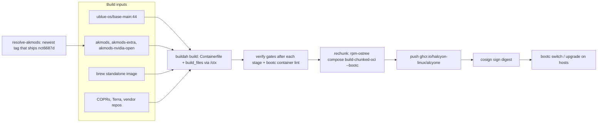

# Halcyon — `alcyone`

A signed, bootc-native Fedora Atomic image for an NVIDIA gaming workstation. Built from a single `Containerfile` on top of Universal Blue `base-main`, with the OGC gaming kernel, the NVIDIA **open** kernel modules, and a Hyprland + Noctalia desktop.

|                   |                                                                                    |
| ----------------- | ---------------------------------------------------------------------------------- |
| **Image**         | `ghcr.io/halcyon-linux/alcyone` (tags `stable`, `latest`, `YYYYMMDD`: same digest) |
| **Base**          | `ghcr.io/ublue-os/base-main:44` (Fedora 44, x86_64)                                |
| **Kernel**        | OGC (Open Gaming Collective) kernel from `ublue-os/akmods`, version-locked         |
| **GPU**           | NVIDIA open modules (`akmods-nvidia-open`), multilib                               |
| **Extra kmod**    | `nct6687d` only (NCT6687 sensors, MSI Z790-P target)                               |
| **Desktop**       | SDDM + Hyprland + Noctalia shell                                                   |
| **Update stack**  | bootc / rpm-ostree, `uupd`, greenboot                                              |
| **Signing**       | cosign key pair; the public key is [`cosign.pub`](cosign.pub)                      |
| **Source branch** | `containerfile` (default and release branch)                                       |
| **License**       | Apache-2.0                                                                         |

## Contents

1. [Before you switch](#before-you-switch)
2. [Install: verify and switch](#install-verify-and-switch)
3. [Enforce signature checks on your host](#enforce-signature-checks-on-your-host)
4. [Update and roll back](#update-and-roll-back)
5. [Test a local build](#test-a-local-build)
6. [Using the system](#using-the-system)
7. [What's in the image](#whats-in-the-image)
8. [Architecture](#architecture)
9. [Build locally](#build-locally)
10. [CI/CD](#cicd)
11. [Build-time verification gates](#build-time-verification-gates)
12. [Security and supply-chain posture](#security-and-supply-chain-posture)
13. [Design decisions](#design-decisions)
14. [Roadmap](#roadmap)
15. [Repository layout](#repository-layout)
16. [Contributing](#contributing)
17. [Upstream and license](#upstream-and-license)

---

## Before you switch

This is a personal, opinionated image. Check these first:

- **NVIDIA GPU required.** The open kernel modules support Turing (GTX 16 / RTX 20) and newer cards only.
- **Your dotfiles will be replaced.** On first login the image clones the maintainer's dotfiles ([`aahsnr-configs/dotfiles`](https://github.com/aahsnr-configs/dotfiles)) and applies them to `$HOME` with `--force`. To opt out, run `sudo systemctl --global disable chezmoi-init.service chezmoi-update.timer` before your first login (details in [Dotfiles with chezmoi](#dotfiles-with-chezmoi)).
- **Signatures are not enforced by default.** Stock hosts accept any image from `ghcr.io`. Verify before installing, and read [Enforce signature checks](#enforce-signature-checks-on-your-host) if you want automatic updates.
- **No installer.** This repository builds neither ISOs nor disk images. Install any bootc-capable Fedora Atomic system (Silverblue, Kinoite, Bazzite, Bluefin, …) and switch to this image, or build a disk image yourself with `bootc-image-builder`.

---

## Install: verify and switch

Run these on the Atomic host you are converting. The steps verify the image's signature, then pin your host to the exact digest you verified.

### 1. Check your tools

```bash
command -v cosign skopeo curl openssl jq
cosign version        # use v3.1.3 or newer
```

- `base-main` ships `cosign`; check that its version is v3.1.3 or newer. v3.1.3 fixes GHSA-fx35-mq7g-6g98, a verification bypass involving legacy-format bundles, which is the format this image uses.
- Elsewhere, install it from <https://docs.sigstore.dev/cosign/system_config/installation/>.
- If you cannot install packages on the host, run the verification inside a Toolbx or Distrobox container.

### 2. Get the public key and check its fingerprint

```bash
curl -fsSLO https://raw.githubusercontent.com/halcyon-linux/base-image/containerfile/cosign.pub
openssl pkey -pubin -in cosign.pub -outform DER | sha256sum
# expected: 9410658270bd845ed529f5f2a2f6a1a62bc5c28a49456b6cc4d97d57b1dca240  -
```

If the hash differs, stop: the key was rotated, or the file was tampered with. This README and `cosign.pub` live in the same repository, so for independent confirmation compare against a second source (a different clone, the git history). After a deliberate key rotation, update the fingerprint here.

### 3. Resolve the tag to a digest

Verifying a digest instead of a tag avoids a race where the tag moves between verification and deployment.

```bash
IMAGE=ghcr.io/halcyon-linux/alcyone
DIGEST=$(skopeo inspect --format '{{.Digest}}' docker://$IMAGE:stable)
echo "$DIGEST"      # sha256:…
```

### 4. Verify the signature

```bash
cosign verify --key cosign.pub "$IMAGE@$DIGEST"
```

Success means exit code `0`, a report that the signatures were verified against the supplied public key, and JSON whose `critical.image.docker-manifest-digest` equals `$DIGEST`. To check that field in a script:

```bash
cosign verify --key cosign.pub "$IMAGE@$DIGEST" \
  | jq -e --arg d "$DIGEST" '.[0].critical.image["docker-manifest-digest"] == $d'
```

A non-zero exit means **do not deploy**.

### 5. Inspect the image (optional)

```bash
skopeo inspect "docker://$IMAGE@$DIGEST" | jq '.Labels'
```

Useful labels: `org.opencontainers.image.version`, `org.opencontainers.image.revision` (git SHA), `org.opencontainers.image.created`, `ostree.linux` (kernel).

### 6. Switch and reboot

```bash
sudo bootc switch "$IMAGE@$DIGEST"
sudo systemctl reboot
```

After the reboot, confirm:

```bash
bootc status
jq . /usr/share/ublue-os/image-info.json
```

**You are now pinned to that digest.** `bootc upgrade`, `ujust update` and `uupd` will not move the OS image until you switch again. To take a newer build, repeat steps 3–6.

To track the `stable` channel instead (`sudo bootc switch "$IMAGE:stable"`), first [enforce signature checks](#enforce-signature-checks-on-your-host). Otherwise tag updates are not signature-checked, and re-running steps 3–4 right before the switch is your only protection.

**Hosts with rpm-ostree but no bootc:** `sudo rpm-ostree rebase ostree-unverified-registry:ghcr.io/halcyon-linux/alcyone:stable`. This follows the tag, so the digest you verified is not enforced. Prefer bootc where available.

### How signing works

- CI pushes the image, then signs the **manifest digest** with a self-managed ECDSA P-256 key (`SIGNING_SECRET` in GitHub Actions).
- `stable`, `latest` and the dated tag point at the same digest at push time, so one signature covers all three.
- The command is `cosign sign --key … --new-bundle-format=false --use-signing-config=false`. It produces a **legacy-format** signature stored in the registry next to the image (tag `sha256-<digest>.sig`). These flags are deprecated and slated for removal in cosign v4, so the signing format may change.
- Open item A-002: nobody has yet confirmed that `cosign.pub` matches the CI `SIGNING_SECRET`. See [Security](#security-and-supply-chain-posture).

### Troubleshooting

| Symptom                                    | Likely cause and action                                                                                                                                                           |
| ------------------------------------------ | --------------------------------------------------------------------------------------------------------------------------------------------------------------------------------- |
| `no signatures found`                      | Make sure you passed `@$DIGEST`, not a tag. Update cosign: v3.1+ detects the legacy format itself. On older releases retry with `--new-bundle-format=false`.                      |
| Transparency-log errors                    | The signing flags are in `.github/workflows/build.yml`. Check how the signature was recorded before relaxing tlog checks (`--insecure-ignore-tlog`), and only do so deliberately. |
| `invalid signature` / fingerprint mismatch | Wrong or rotated key. Re-check step 2. Treat as a security event until explained.                                                                                                 |
| `denied`, `unauthorized`, rate limiting    | Retry later, or authenticate with `podman login ghcr.io` / `skopeo login ghcr.io`.                                                                                                |

If the signature verifies but you end up with a different image, you deployed something other than the digest you verified. Always deploy the same `@sha256:` digest.

---

## Enforce signature checks on your host

`bootc` and `rpm-ostree` fetch images under `/etc/containers/policy.json`. The stock default accepts any content for registries without an explicit rule, so updates to a mutable tag (`:stable`, `:latest`), which is what `uupd` pulls, are not signature-checked. [CVE-2026-16487](https://www.cve.org/CVERecord?id=CVE-2026-16487) (bootc, published 2026-10-19) describes this: upgrading a mutable tag may apply unsigned content when the policy falls through to `insecureAcceptAnything`. Red Hat's listed workaround is to pin updates to digests, or to configure `policy.json` to reject unsigned content and allow only trusted signed scopes. The bootc maintainers treat deferring to `policy.json` as intended behavior, so the fix belongs in your host policy.

This repository ships no `policy.json` or `registries.d` entry for `ghcr.io/halcyon-linux`, so enforcement is something you add. Run these from the directory holding the `cosign.pub` you verified in step 2:

```bash
# 1. Install the verification key
sudo install -Dm0644 cosign.pub /etc/pki/containers/halcyon-linux.pub

# 2. Tell containers/image to look for cosign signatures stored in the registry
sudo tee /etc/containers/registries.d/halcyon-linux.yaml >/dev/null <<'EOF'
docker:
  ghcr.io/halcyon-linux:
    use-sigstore-attachments: true
EOF

# 3. Add a signature requirement for this image, keeping the rest of your policy
sudo cp -a /etc/containers/policy.json /etc/containers/policy.json.bak
jq '.transports.docker["ghcr.io/halcyon-linux/alcyone"] = [{
      "type": "sigstoreSigned",
      "keyPath": "/etc/pki/containers/halcyon-linux.pub",
      "signedIdentity": { "type": "matchRepository" }
    }]' /etc/containers/policy.json.bak | sudo tee /etc/containers/policy.json >/dev/null
```

From now on, `bootc switch`, `bootc upgrade` and `uupd` reject unsigned or wrongly signed content for this image, for tags and digests alike. On rpm-ostree, use the `ostree-image-signed:docker://ghcr.io/halcyon-linux/alcyone:stable` form; `ostree-unverified-registry:` bypasses the policy by design.

**Optional, stricter:** set `"default": [{"type": "reject"}]` in `policy.json` and explicitly allow every registry you pull from (for example `"docker.io": [{"type": "insecureAcceptAnything"}]`), or `podman pull` and Toolbx/Distrobox will break. With that in place `bootc switch --enforce-container-sigpolicy …` succeeds; the flag only checks that the _default_ policy requires signatures, so it fails with just the per-image rule above.

**Also:**

- If a deployment was staged before you tightened the policy, discard it before rebooting (`sudo rpm-ostree cleanup -p`). Staged deployments are not re-checked against the current policy (CVE-2026-16460).
- This image disables `rpm-ostreed-automatic.timer` and sets `AutomaticUpdatePolicy=none`; `uupd.timer` is the one automatic updater. It does not touch `bootc-fetch-apply-updates.timer`. If `systemctl is-enabled bootc-fetch-apply-updates.timer` says enabled and you are not enforcing signatures, disable it.
- `ujust verify-image` only rewrites an `ostree-unverified-registry:` deployment reference to `ostree-image-signed:docker://…` and rebases. It does **not** run cosign, and the signed form is only checked if the policy above is in place.

---

## Update and roll back

Updates are staged, then applied on reboot.

```bash
ujust update           # alias: ujust upgrade (runs uupd-update)
sudo bootc upgrade     # manual equivalent for the OS image
bootc status           # booted / staged / rollback deployments
```

- `uupd` is the only automatic updater (`uupd.timer` enabled). It follows the ref you deployed: a tag follows new builds, a digest stays put.
- `ujust topgrade` runs topgrade with `/usr/share/ublue-os/topgrade.toml` (bootc, firmware, Flatpak, Homebrew, Nix). Plain `topgrade` only reads `~/.config/topgrade.toml` and defaults to `dnf`, which does not apply here; set `[linux] bootc = true` there if you prefer to call it directly.
- Lynis `PKGS-7420` (no `dnf-automatic`) is skipped in `/etc/lynis/custom.prf` because `uupd` is the updater. `NAME-4028` is satisfied by `halcyon-hosts-entry`, which writes `127.0.1.1 <host>.localdomain <host>` so `dnsdomainname` returns `localdomain`.
- `ujust changelogs` opens the commit history of the `containerfile` branch.

### Roll back

```bash
sudo bootc rollback    # then reboot
brh                    # guided rollback / rebase helper
```

GRUB shows its menu for 10 seconds (`GRUB_TIMEOUT=10`, `GRUB_TIMEOUT_STYLE=menu`), so you can boot an older deployment or edit kernel arguments. The `greenboot` health-check and rollback-trigger services are enabled.

---

## Test a local build

Local builds are unsigned (see [Build locally](#build-locally)). To boot one, put it in root's container storage and switch with the `containers-storage` transport:

```bash
podman save localhost/alcyone-build:44-containerfile | sudo podman load
sudo bootc switch --transport containers-storage localhost/alcyone-build:44-containerfile
sudo systemctl reboot
```

The tag suffix is your git branch (`44-<branch>`). Your previous deployment stays available for rollback. When you are done, switch back to the published image (steps 3–6 above).

---

## Using the system

### `ujust` recipes

Run `ujust` for the full list. Commonly used:

| Recipe                                              | Purpose                                                                                                         |
| --------------------------------------------------- | --------------------------------------------------------------------------------------------------------------- |
| `update` / `upgrade`                                | Update the OS image and apps via `uupd`                                                                         |
| `changelogs`                                        | Open recent image changes                                                                                       |
| `verify-image`                                      | Rebase an unverified ref to `ostree-image-signed:` form (no cosign check)                                       |
| `dotfiles`                                          | chezmoi menu: `status`, `sync`, `diff`, `edit`                                                                  |
| `configure-grub`, `regenerate-grub`, `grub-timeout` | GRUB maintenance                                                                                                |
| `configure-snapshots`, `configure-beesd`            | Btrfs snapshots and deduplication                                                                               |
| `tailscale`                                         | Manage Tailscale                                                                                                |
| `update-nvidia-runtime`                             | Sync the NVIDIA Flatpak runtime                                                                                 |
| `aide-init`, `aide-check`, `aide-rebaseline`        | AIDE file-integrity baseline and checks                                                                         |
| `audit-status`, `audit-report`, `audit-lock`, `audit-unlock` | Show audit state, summarise failed events, lock or unlock the audit rules (`-e 2`); see [Auditing with auditd](#auditing-with-auditd) |
| `nix-relabel-unit [unit\|store path]`               | Relabel Nix store paths holding systemd units; see [Nix, Home Manager and flakes](#nix-home-manager-and-flakes) |

### Installing software

Keep the image clean: prefer Homebrew, Flatpak, Nix, Distrobox or containers over layering RPMs. The image declares only the Flathub remote (system Flatpaks live in `/var/lib/flatpak`) and ships no Flatpak apps.

### Nix, Home Manager and flakes

Nix is preinstalled and configured, so there is no installer to run — do **not** use the Determinate installer, which dropped OSTree support ([nix-installer#1797](https://github.com/DeterminateSystems/nix-installer/pull/1797)). The image ships `nix`, `nix-daemon`, and `busybox`, which Fedora's `nix` is compiled against as its build-sandbox shell (`-Dlibstore:sandbox-shell=/usr/bin/busybox`); without it every sandboxed build fails with `getting attributes of path "/usr/bin/busybox"`. `/nix` is a bind mount of `/var/nix`, the daemon runs multi-user, and `nix.conf` enables `nix-command` and `flakes`, so flakes need no extra flags.

Set up Home Manager with:

```bash
nix run home-manager/master -- init --switch
```

Then, in `home.nix`:

- `targets.genericLinux.enable = true` — integrates Nix packages with a non-NixOS system. It currently duplicates entries in `$PATH` and `$XDG_DATA_DIRS` ([home-manager#8076](https://github.com/nix-community/home-manager/issues/8076)).
- `fonts.fontconfig.enable = true` for Nix-installed fonts. Flatpak apps also need `flatpak override --user --filesystem=/nix/store:ro --filesystem=xdg-config/fontconfig:ro` before they can see them.
- `targets.genericLinux.gpu` for GPU access, which creates `/run/opengl-driver`. Nix packages look for drivers there and nothing else on this image provides it. `home-manager switch` prints a `sudo /nix/store/<hash>-non-nixos-gpu/bin/non-nixos-gpu-setup` command to run; it installs a `tmpfiles.d` config, so it needs no relabel.

**A systemd unit built into the store needs one manual step.** Nix does not set SELinux labels on store paths it creates, so a unit in the store is `default_t`, which `init_t` may not read, and `systemctl enable` on it fails with `Access denied` ([home-manager#8438](https://github.com/nix-community/home-manager/issues/8438)). Relabel after each rebuild that produces a new store path:

```bash
ujust nix-relabel-unit                      # every unit under /etc/systemd/system that points into the store
ujust nix-relabel-unit myservice.service    # or one already enabled
ujust nix-relabel-unit /nix/store/<hash>-<pkg>/lib/systemd/system   # or one not enabled yet
```

Two more things to expect:

- Distrobox containers need the store and drivers mounted: `distrobox create --name fedora-44 --volume /nix:/nix:ro --volume /run/opengl-driver:/run/opengl-driver:ro`. Toolbx cannot mount volumes at all.
- On the first boot after an image update, `nix-daemon.socket` is listed as failed and the system reports `degraded`. Nix still works — `nix-daemon.service` binds the socket itself — and later boots are clean. See the Nix entry under [Security and supply-chain posture](#security-and-supply-chain-posture).

### Runtime facts

- Root on Btrfs with zstd and `bees` deduplication; use `compsize` to measure savings.
- Kernel and NVIDIA driver are built against the same akmods tag and move together.
- Steam does not autostart on first login.

### Auditing with auditd

`auditd` records security-relevant events (changes to accounts, sudo, SSH, PAM, SELinux and audit configuration, kernel modules, persistence points and package managers, plus use of setuid binaries and denied access to sensitive paths) in `/var/log/audit/audit.log`. It is on by default. Everything below needs `sudo`, because the log is readable by root only. What the rules cover and why some activity is left out is described under [Security and supply-chain posture](#security-and-supply-chain-posture).

#### Check that it works

After the first boot of an image that carries these rules:

```bash
systemctl status auditd audit-rules      # both active; audit-rules is a one-shot and shows "active (exited)"
sudo auditctl -s                         # expect: enabled 1, backlog_limit 8192, lost 0
sudo auditctl -l | head                  # Halcyon rules; must NOT be a lone "-a never,task"
sudo ls /etc/audit/rules.d               # no audit.rules; 10-base-config.rules ... 99-finalize.rules
cat /proc/cmdline | tr ' ' '\n' | grep audit    # audit=1 and audit_backlog_limit=8192
```

If `/etc/audit/rules.d/audit.rules` is still there, remove it. Fedora's copy contains `-a task,never`, which turns syscall auditing off, and it sorts after every numbered file, so it would cancel the Halcyon rules. It survives an update only if it was edited locally, because bootc keeps local changes to `/etc`:

```bash
sudo rm /etc/audit/rules.d/audit.rules && sudo augenrules --load
```

#### Where things live

| Path                                 | Purpose                                                                                                |
| ------------------------------------ | ------------------------------------------------------------------------------------------------------ |
| `/etc/audit/rules.d/*.rules`         | Rule files, merged in natural (`sort -V`) order by `augenrules` at boot. Only names ending in `.rules` |
| `/etc/audit/audit.rules`             | The merged result, generated by `augenrules`. Do not edit it                                           |
| `/etc/audit/auditd.conf`             | Daemon settings: log format, rotation, disk-space actions                                              |
| `/etc/audit/plugins.d/`              | Event dispatcher plugins (`sedispatch` for setroubleshoot is active; the `audispd-plugins` ones are off) |
| `/var/log/audit/audit.log`           | The log, mode 0700 directory, root only                                                                |

| Rule file                | What it covers                                                                                                                         |
| ------------------------ | -------------------------------------------------------------------------------------------------------------------------------------- |
| `10-base-config.rules`   | `-D`, `-b 8192`, `--backlog_wait_time 60000`, `-f 1`, `--loginuid-immutable`                                                           |
| `12-cont-fail.rules`     | `-c`: keep loading after a bad rule but make `audit-rules.service` fail, so a broken rule is visible                                   |
| `20-dont-audit.rules`    | Noise filters: cron jobs, chrony clock slewing, tracefs/debugfs, kernel keyring events                                                 |
| `30-identity.rules`      | Account, sudo/polkit, PAM, SSH and host-identity files                                                                                 |
| `31-privileged.rules`    | Generated at image build: execution of every setuid/setgid or file-capability binary under `/usr` by a real user                       |
| `32-power-abuse.rules`   | Root (after sudo/su) touching files owned by another user in `/var/home`                                                               |
| `40-kernel.rules`        | Module load/unload, kexec, bpf by real users, ptrace code injection, clock changes, swap, sysctl/modprobe/ld.so configuration          |
| `41-persistence.rules`   | cron, systemd units under `/etc/systemd/system`, shell start-up files, fstab, crypttab, GRUB, `/boot`                                  |
| `44-installers.rules`    | `dnf5`, `rpm-ostree`, `bootc`, `pipx` run by a real user; repository, Flatpak, container and Nix configuration                         |
| `50-security-config.rules` | SELinux policy and the audit, fail2ban, AIDE, firewalld, NetworkManager and chrony configuration; `setenforce`, `semodule`, `auditctl` and similar tools |
| `60-access-denied.rules` | Failed opens (`EACCES`/`EPERM`) by a real user under `/etc`, `/var/roothome`, `/boot`, `/var/log/audit`, `/var/lib/aide`              |
| `99-finalize.rules`      | `-e 1`: auditing enabled, rules changeable                                                                                             |

"Real user" means a login uid of 1000 or more that is set (`auid>=1000`, `auid!=unset`), so services that start at boot are not logged.

#### Event keys

Every rule carries a key. Search by key with `ausearch -k <key>`.

| Key                                                    | Event                                                                  |
| ------------------------------------------------------ | ---------------------------------------------------------------------- |
| `identity`                                             | Write to passwd, shadow, group, gshadow, subuid or subgid              |
| `sudoers`                                              | Change to sudoers, `sudoers.d` or polkit rules                         |
| `auth-config`                                          | Change to login.defs, nsswitch, PAM, `/etc/security` or authselect     |
| `sshd-config`                                          | Change under `/etc/ssh`                                                |
| `system-identity`                                      | Change to `/etc/hostname`, `/etc/hosts`, `/etc/issue`, `/etc/issue.net` |
| `module-load`, `module-unload`                         | Kernel module inserted or removed                                      |
| `kexec`                                                | `kexec_load` / `kexec_file_load`                                       |
| `bpf`                                                  | bpf syscall by a real user                                             |
| `code-injection`, `data-injection`, `register-injection` | ptrace POKETEXT, POKEDATA, SETREGS                                   |
| `time-change`                                          | Wall-clock changes (not chrony)                                        |
| `swap`                                                 | `swapon` / `swapoff`                                                   |
| `kernel-config`, `ld-preload`                          | modprobe.d, modules-load.d, sysctl, `ld.so.*`                          |
| `persistence-cron`, `persistence-systemd`, `persistence-shell` | cron, `/etc/systemd/system`, shell start-up files              |
| `boot-config`                                          | fstab, crypttab, GRUB configuration, `/boot`                           |
| `software-installer`, `package-config`                 | Package manager run; repository and tool configuration changed         |
| `selinux-config`, `selinux-tool`                       | SELinux config or policy changed; `setenforce`, `semodule` and friends run |
| `audit-config`, `audit-tool`                           | Audit configuration changed; `auditctl` / `augenrules` run             |
| `security-tools`, `firewall-config`, `network-config`  | fail2ban, AIDE, firewalld, NetworkManager, chrony configuration        |
| `privileged`                                           | Setuid/setgid or file-capability binary executed                       |
| `power-abuse`                                          | Root reading or changing another user's files in `/var/home`           |
| `access-denied`                                        | Permission denied on a sensitive path                                  |

#### Searching and reporting

Add `-i` to turn numbers into names (uids, syscalls, times). Use `--input-logs` when scripting, otherwise `ausearch` waits on standard input.

```bash
sudo ausearch -k identity -ts today -i                  # who touched account files today
sudo ausearch -k privileged -ts recent -i               # setuid binaries run in the last 10 minutes
sudo ausearch -k access-denied -ts yesterday -te today -i
sudo ausearch -m avc -ts recent -i                      # SELinux denials (also: sudo sealert -a /var/log/audit/audit.log)
sudo ausearch -ui 1000 -k software-installer -i         # what one user installed
sudo aureport --summary                                 # event counts by type
sudo aureport --key --summary                           # event counts by key: shows what is noisy
sudo aureport --auth --failed --summary                 # failed logins
sudo aureport -x --summary                              # which executables generate the most events
ujust audit-status                                      # auditctl -s and rule count
ujust audit-report                                      # aureport summary of failed events
```

Reading an event: `auid` is the user who logged in and stays the same after `sudo` or `su`; `uid` is the user the process runs as now. `key=` names the rule that fired. The log is in `ENRICHED` format, so interpreted names such as `UID="root" AUID="alice"` appear next to the numbers.

#### Adding, silencing and testing rules locally

Put local rules in your own file under `/etc/audit/rules.d/`, not in a shipped file: bootc keeps local `/etc` edits across updates, so an edited shipped file stops receiving image changes (`sudo ostree admin config-diff | grep audit` lists what you changed). A new file is also found by `sort -V`, so its name decides where it sits:

- **Silence something**: audit rules on the `exit` list are first-match-wins, so a `never` rule must sort before the rule it suppresses. Use a name below `30`, for example `25-local-exclude.rules`:

  ```text
  # Stop logging opens under /etc by one noisy program
  -a never,exit -F arch=b64 -S open,openat,openat2 -F dir=/etc -F exe=/usr/bin/some-program
  ```

- **Add something**: use a name after `60` and before `99`, for example `70-local.rules`:

  ```text
  -a always,exit -F arch=b64 -F path=/etc/my.conf -F perm=wa -F key=my-config
  ```

- **Raise the queue** if `auditctl -s` reports `lost` above 0: `augenrules` keeps the last `-b` it reads, so a file such as `15-local-backlog.rules` containing `-b 16384` wins over the shipped `-b 8192` (and set the same value with `audit_backlog_limit=` if you also want it before auditd starts).

Rules use `auid>=1000 -F auid!=unset` for real users; the first regular user on Fedora is uid 1000 (`grep UID_MIN /etc/login.defs`). Use `path=` for a file and `dir=` for a directory tree, with one rule per ABI (`arch=b32` and `arch=b64`) when the rule uses `perm=`. Keys are limited to 31 characters. A `dir=` target must exist when the rules load, and `dir=` on a symlink matches nothing (`/home` and `/root` are symlinks here, so use `/var/home` and `/var/roothome`). A rule identical to an existing one is rejected as a duplicate. Give the file mode 0600 and a `.rules` suffix; never name a file `audit.rules`.

Load and check:

```bash
sudo augenrules --load            # merge /etc/audit/rules.d and load it; errors are printed
systemctl status audit-rules      # must not be "failed"
sudo auditctl -l | grep my-config # the rule is active
```

`augenrules --check` only reports whether the merged result differs from `/etc/audit/audit.rules`; it does not check syntax, so load to test. To try a rule without keeping it, run `sudo auditctl -a …` with the same arguments: it is gone after a reboot.

#### Locking the rules (`-e 2`)

By default the rules end with `-e 1`: auditing is on and root can change the rules. With `-e 2` the configuration is immutable until reboot, so even a root attacker cannot turn auditing off or edit the rules (any attempt is denied and itself audited). The cost is that no rule can change without a reboot.

```bash
ujust audit-lock      # writes /etc/audit/rules.d/99-zz-lock.rules (-e 2) and loads it now
ujust audit-unlock    # removes that file; if the running kernel is locked, reboot to unlock
```

`99-zz-lock.rules` sorts after `99-finalize.rules`, and `augenrules` always places the last `-e` it reads at the end of the merged file, so the lock wins. The file lives in `/etc`, so the lock survives reboots and image updates until you run `ujust audit-unlock`. While locked, `augenrules --load` and `auditctl` changes fail with an immutable-mode or "Operation not permitted" error, and `ujust audit-status` prints `enabled 2`.

#### Log size and rotation

`auditd.conf` keeps up to 10 logs of 50 MB (500 MB at most), rotates when one is full, and answers low space, a full disk or a disk error with a `SYSLOG` message, never by suspending or halting the machine. It warns at 75 MB free and 50 MB free.

```bash
sudo du -sh /var/log/audit
sudo auditctl --signal rotate     # rotate now
sudo auditctl --reset-lost        # zero the lost-events counter after fixing the backlog
journalctl -b -u auditd           # disk-space warnings appear here
```

Check `du` and `aureport --key --summary` after a day of normal use: the rules are meant to be quiet on a desktop, and a key with thousands of events is a rule to silence locally. After changing `auditd.conf`, run `sudo auditctl --signal reload`. `auditd` refuses a plain `systemctl restart`.

#### Troubleshooting

| Symptom                                           | Cause and fix                                                                                                                                                                  |
| ------------------------------------------------- | ------------------------------------------------------------------------------------------------------------------------------------------------------------------------------ |
| `audit-rules.service` is `failed`                 | At least one rule was rejected (the rest still loaded, because of `-c`). Read `sudo journalctl -u audit-rules -b` and fix the line it names; common errors: `Rule exists` (duplicate), `Unknown syscall` (name not valid for that `arch`, for example `kexec_file_load` on `b32`), `No such file or directory` (a `dir=` target missing) |
| `auditctl -l` prints `No rules`                   | `audit-rules.service` did not run or all rules failed; check `systemctl status audit-rules`, and `cat /proc/cmdline` for `audit=0`, which disables auditing                      |
| `auditctl -l` shows only `-a never,task`          | The stock `audit.rules` is back: `sudo rm /etc/audit/rules.d/audit.rules && sudo augenrules --load`                                                                           |
| `auditctl -s` shows `enabled 2`                   | Rules are locked: reboot after `ujust audit-unlock` to change them                                                                                                            |
| `lost` or `backlog` keeps growing                 | The event queue overflowed. Raise `-b` (see above), find the noisy key with `aureport --key --summary`, and silence it                                                          |
| `ausearch` prints nothing or hangs                | Run it with `sudo`; add `--input-logs` in scripts                                                                                                                              |
| Login inside a systemd container fails            | `--loginuid-immutable` (in `10-base-config.rules`) can break `pam_loginuid` in some containers. Remove that line from a local copy only if you hit it                           |
| SELinux denials not shown                         | AVC records are always logged; search `-m avc`. Confinement problems are not an audit-rules matter                                                                            |

#### Sending events off the machine

Local logs are the first thing an attacker with root edits. `audispd-plugins` is installed with every dispatcher plugin set to `active = no`; the image ships no remote collector. To forward events to a collector you run, set `active = yes` in `/etc/audit/plugins.d/au-remote.conf`, set `remote_server` in `/etc/audit/audisp-remote.conf`, then `sudo auditctl --signal reload`. The edit itself is audited (`audit-config`).

### Dotfiles with chezmoi

The image installs `chezmoi` and wires it through systemd user units to [`aahsnr-configs/dotfiles`](https://github.com/aahsnr-configs/dotfiles). Upstream docs: <https://chezmoi.io>.

> **This is the maintainer's personal repo.** On first login it is cloned and force-applied to your `$HOME`, and a daily timer keeps it applied.
>
> - Opt out for every user: `sudo systemctl --global disable chezmoi-init.service chezmoi-update.timer`
> - Opt out for one user: `systemctl --user mask chezmoi-init.service chezmoi-update.timer`

| Component                | When it runs                                       | What it does                                                                 |
| ------------------------ | -------------------------------------------------- | ---------------------------------------------------------------------------- |
| `chezmoi-init.service`   | At login, if `~/.local/share/chezmoi/.git` missing | `chezmoi init --apply --force aahsnr-configs/dotfiles` (5 attempts in 5 min) |
| `chezmoi-update.timer`   | 5 min after boot, then daily                       | Triggers the update service                                                  |
| `chezmoi-update.service` | By the timer                                       | `chezmoi update --no-tty --force` (pull and apply)                           |
| `ujust dotfiles`         | Manual                                             | Menu: `status` / `sync` / `diff` / `edit`                                    |

- Units live in `/usr/lib/systemd/user/` (read-only, replaced on image updates). They skip system accounts and the `sddm` greeter.
- The dotfiles repo is public, so clones and pulls use anonymous HTTPS. After init, the service rewrites only **pushes** to SSH (`pushInsteadOf`) and pins `core.sshCommand` to `~/.ssh/id_ed25519_aahsnr_configs`. Manual pushes need that key. `/etc/ssh/ssh_config.d/10-halcyon-github.conf` uses the same key for `github.com`.
- Handy checks:

  ```bash
  systemctl --user list-timers chezmoi-update.timer     # next scheduled update
  journalctl --user -u chezmoi-update.service -e        # last update's log
  ```

**Gotchas**

- The daily timer **silently reverts** `$HOME` edits that were not added back. Edit through chezmoi (`chezmoi edit --apply <file>`) or `chezmoi add` the change.
- The first apply overwrites managed files that differ; run `chezmoi diff` first on an existing machine.
- Update conflicts are git conflicts in the source directory: `chezmoi cd`, resolve, commit, push, then `chezmoi apply --force`.
- Deleting `~/.local/share/chezmoi` is recoverable: the next login re-clones and force-applies.
- Never `chezmoi add` plaintext secrets; use `chezmoi add --encrypt` (age/GPG) or a password manager via templates.
- chezmoi owns `$HOME` only. Machine-level config belongs in this image's build files.

---

## What's in the image

Full package lists live in [`packages.json`](packages.json). Highlights:

| Area                    | Contents                                                                                                                                                                                                                                |
| ----------------------- | --------------------------------------------------------------------------------------------------------------------------------------------------------------------------------------------------------------------------------------- |
| **Desktop**             | SDDM (default target `graphical.target`), Hyprland + Noctalia, Bazaar software center (Flathub declared, no Flatpak apps pre-installed)                                                                                                 |
| **Shell and CLI**       | zsh as the default login shell (fish and `greetd` removed); a pinentry dispatcher (GUI in a graphical session, curses/tty otherwise); `bat`, `eza`, `fzf`, `ripgrep`, `atuin`, `starship`, `zellij`, `yazi`, `lazygit`, `uv`, `pixi`, … |
| **Gaming**              | Steam (no autostart), Lutris, gamescope, MangoHud, vkBasalt, umu-launcher, ProtonPlus, Heroic, winetricks, `scx` schedulers, `ds-inhibit`, `input-remapper`. Handheld packages removed; Waydroid intentionally absent                   |
| **System**              | Btrfs tooling (`btrfs-assistant`, `snapper`, `compsize`), `bees` deduplication (timers via `ujust configure-beesd`), greenboot, `fail2ban`, `lynis`, Tailscale (installed, `tailscaled` disabled)                                       |
| **Package ecosystems**  | Homebrew (standalone), Nix (`nix`, `nix-daemon`, `busybox` for the Nix build sandbox shell, `/nix` mount units for the immutable root), Distrobox/Toolbx, Flatpak runtime                                                               |
| **Apps and toolchains** | Firefox, Chrome, Brave, Edge, Vivaldi, Zen; VS Code, VSCodium, Zed, Neovim, Emacs; Obsidian, OnlyOffice, Bitwarden; Go, Rust (`cargo`), Node 22, CMake, Ninja; TeX Live with formats baked at build time                                |
| **Runtime tuning**      | zram, sysctl drop-ins (gaming, networking, inotify), TuneD profiles (`*-bazzite`), an optional 1 GiB hugepage mount, `ntsync` module load                                                                                               |

### Package sources and repository lifecycle

| Source                                                                                                               | Used for                                                                                                | Lifecycle                                                                 |
| -------------------------------------------------------------------------------------------------------------------- | ------------------------------------------------------------------------------------------------------- | ------------------------------------------------------------------------- |
| `ublue-os/base-main:44`                                                                                              | Base OS                                                                                                 | Image base                                                                |
| `ublue-os/akmods*` images                                                                                            | Kernel, kmods, NVIDIA RPMs                                                                              | Build inputs only                                                         |
| `ublue-os/{bazzite,bazzite-multilib,staging,packages}` COPRs                                                         | Patched bluez and Xwayland (`bazzite-multilib`), Bazaar and media-automount (`packages`), helpers       | Enabled for the build, **disabled in the shipped image**                  |
| Terra (`terra`, `terra-extras`, `terra-mesa`)                                                                        | gamescope, MangoHud, wireplumber, mesa bits                                                             | Priority 1 with excludes; disabled in the shipped image                   |
| `aahsnr-work/cli-tools`, `python-packages`, `gaming`, `fonts`, `base-pkgs`, `applications`, `texlive-packages` COPRs | The Halcyon package sets                                                                                | Enabled at `priority=1` inside its own script, disabled before it returns |
| Vendor repos (Tailscale, GitHub CLI, VS Code, VSCodium, Brave, Chrome, Edge, Vivaldi)                                | Their packages                                                                                          | Disabled in the shipped image by `configure-system-policy`                |
| GitHub releases and raw files via `ghcurl`                                                                           | `cicpoffs`, `extest`, `ujust-picker`, winetricks, DXVK example config, Distrobox template, bash-preexec | Downloaded at build time                                                  |

Version-locked packages: kernel set, `bluez*`, `xorg-x11-server-Xwayland`, core `mesa-*`, `NetworkManager*`.

---

## Architecture

### bootc model

The whole OS is one OCI image. Nothing is installed package-by-package on the live host:

- `/usr` is read-only and comes entirely from the image.
- `/etc` holds image defaults plus local overrides; `/var` is machine-local state.
- An update pulls a new image into a staged deployment; the previous deployment remains for rollback.
- `bootc container lint` is the last instruction in the `Containerfile` and gates every build.

### Pipeline



### Kernel and driver selection

`just_scripts/resolve-akmods` walks published `akmods-extra` tags newest-first (`ogc-44-<kernel-version>`) and picks the first tag where:

1. `akmods`, `akmods-extra` **and** `akmods-nvidia-open` are all published for that tag, and
2. the `akmods-extra` payload actually contains the `nct6687d` kmod.

If no tag qualifies, the build refuses to run. CI and `just build` both use this, so the Containerfile carries no hardcoded kernel version. A bare `podman build` falls back to the floating tag `ogc-44-x86_64`.

The kernel swap (`build_files/kernel/install-kernel-akmods`) removes the stock kernel, installs the OGC RPMs, adds a `dnf5 versionlock`, and installs only `nct6687d` from the extra kmods. NVIDIA modules come from prebuilt RPMs via `nvidia-install.sh` (`MULTILIB=1`); `nvidia-gpu-firmware` (nouveau) is removed first.

### Build contract (`/ctx`)

`build_files/` and `packages.json` are exposed as a scratch stage (`ctx`) and bind-mounted at `/ctx`, so scripts never land in image layers. Package-installing `RUN` steps typically:

- mount `/var/cache` and `/var/log` caches and a tmpfs `/tmp`,
- call one script, then `/ctx/finalization/verify <stage>`, then `/ctx/shared/cleanup`,
- mount the `GITHUB_TOKEN` secret where a GitHub download or the NVIDIA installer needs it.

`build_files/shared/dnf5` is a build-only retry shim (up to 5 retries, 60 s apart), installed before the first dnf transaction to survive upstream metadata republishing. It is removed before the final lint.

### Build order

Every step below is followed by its `verify <stage>` gate (see [Build-time verification gates](#build-time-verification-gates)).

1. Copy `system_files/desktop/` to `/`, install the dnf5 retry shim, add the Homebrew standalone files.
2. Swap in the OGC kernel and `nct6687d`.
3. Set up repositories, priorities and excludes.
4. Install the package sets in order: CLI tools, Python utilities, removal of superseded packages, common packages, gaming stack, fonts, Hyprland/Noctalia, applications (browsers, `bees`), TeX Live (then bake its formats), Nix, `ujust-picker`, media automount.
5. Copy `system_files/overrides/` (after packages, so intentional overrides win), then desktop integration, justfiles, services, GRUB, integration files, image-info, initramfs, finalize.
6. NVIDIA: copy its payload, configure, install the driver, apply system policy (disables the remaining build repos), finalize. Then image-info, initramfs and finalize **again**: the second pass must include the NVIDIA modules.
7. Final assertions (`verify final`), remove the dnf5 shim, `bootc container lint`.

### Payload rules

- Static content lives under `/usr`; `/etc` carries defaults and overrides; `finalize` strips `/var`, so nothing static may live there.
- Commands that upstream shipped from `usr/bin` now come from RPMs (`brh`, `bruh`, `crh`, `gameclass`, `ublue-motd`, `uupd-update`, …). `system_files/desktop/usr/bin` intentionally does not exist.

---

## Build locally

Prerequisites: Linux with `podman` (or `podman-remote`), `just`, `git`, `skopeo`, `jq`, outbound network access to `ghcr.io`, Copr and GitHub, and plenty of free disk (CI frees runner disk space before building).

```bash
just                # list recipes
just build          # build alcyone (the only supported target)
just run            # run a shell in the built image (builds first if missing)
just list-images    # list localhost/alcyone*-build images
just clean-images   # remove them
just just-check     # check .just and Justfile formatting (uses `just --unstable`)
```

- `just build` resolves the akmods tag with `resolve-akmods`, then runs `podman build` with the same build args CI uses. The result is tagged `localhost/alcyone-build:44-<git-branch>`.
- Any target other than `alcyone` (or `containerfile`) is rejected by `just_scripts/get-defaults`.
- Overrides: `CONTAINER_MGR` (`podman` or `podman-remote`), `KERNEL_FLAVOR`, `REQUIRED_KMOD`, `AKMODS_TAG`, `KERNEL_VERSION`.
- Local images are **not rechunked and not signed**.
- `just build` does not forward `GITHUB_TOKEN`; GitHub downloads then run unauthenticated and may hit rate limits.

Equivalent manual build (mirrors CI and forwards the token):

```bash
export GITHUB_TOKEN=…   # any token; or delete the --secret line below to build unauthenticated
AKMODS_TAG=$(just_scripts/resolve-akmods ogc 44 x86_64 nct6687d)
KERNEL_VERSION=${AKMODS_TAG#ogc-44-}

podman build -f Containerfile --target alcyone \
  --build-arg FEDORA_VERSION=44 \
  --build-arg KERNEL_FLAVOR=ogc \
  --build-arg AKMODS_TAG="$AKMODS_TAG" \
  --build-arg KERNEL_VERSION="$KERNEL_VERSION" \
  --secret id=GITHUB_TOKEN,env=GITHUB_TOKEN \
  -t localhost/alcyone:dev .
```

The token is optional: without it, `ghcurl` falls back to unauthenticated requests.

Fast checks without a full build:

```bash
bash tests/test-dnf5-retry.sh                                  # dnf5 retry shim self-test
for f in build_files/*/* just_scripts/* tests/*.sh; do bash -n "$f"; done
```

---

## CI/CD

### `.github/workflows/build.yml`: build alcyone

| Item            | Value                                                                                               |
| --------------- | --------------------------------------------------------------------------------------------------- |
| Triggers        | Daily `40 4 * * *` UTC; push to `containerfile` (ignoring `**.md`, `**.txt`); manual dispatch       |
| Runner / limits | `ubuntu-26.04`, 90-minute timeout, free-disk-space step first                                       |
| Permissions     | `permissions: {}` at top level; the job gets `contents: read`, `packages: write`, `id-token: write` |
| Concurrency     | Per trigger; pushes cancel older pushes, manual dispatches are never cancelled by a push            |
| Action pinning  | Every action pinned to a full commit SHA                                                            |

Steps: checkout → `just` syntax check → dnf5 shim test → resolve akmods tag → pull base and akmods images and read the upstream version → `buildah build --target alcyone --build-arg-file build_args.txt --secret id=GITHUB_TOKEN` → compute OCI labels (including `ostree.bootable=true` and `ostree.linux`) → rechunk → log in to GHCR → **push** (`:stable`, then `:latest` and `:YYYYMMDD` copied by digest, with retry) → install cosign `v3.1.3` → **sign the digest**.

Publishing and signing run **only** when `github.ref == refs/heads/containerfile`, so a manual dispatch on another ref or tag cannot overwrite `stable` or `latest`.

Secrets: `SIGNING_SECRET` (cosign private key) and the automatic `GITHUB_TOKEN`.

### `.github/workflows/clean.yml`: cleanup

Sundays 00:15 UTC (and manual): deletes `alcyone` package versions older than 90 days, keeping at least 7 tagged and 7 untagged, and removes orphaned images.

### Run and cancel workflows from the terminal

Requires the [GitHub CLI](https://cli.github.com/) (`gh`) authenticated with `gh auth login`, and a checkout of this repository (or pass `-R halcyon-linux/base-image`).

```bash
# Start a build manually. Runs on the containerfile branch, so it PUBLISHES and SIGNS.
gh workflow run build.yml --ref containerfile

# Start the cleanup workflow manually (it deletes old package versions).
gh workflow run clean.yml --ref containerfile

# Find the run ID of anything in progress.
gh run list --workflow build.yml --status in_progress

# Follow a run until it finishes (pick the ID from the list above).
gh run watch <run-id>

# Cancel a run. This is the normal cancel and stops the run gracefully.
gh run cancel <run-id>

# Force cancel a run that stays "cancelling" after a normal cancel.
gh api --method POST repos/halcyon-linux/base-image/actions/runs/<run-id>/force-cancel
```

Pushes cancel older pushes automatically, but a manual run is never cancelled by a push, so only your `gh run cancel` stops it. Publishing is ordered (`:stable` first, then `:latest` and `:YYYYMMDD` copied by digest), so cancelling during the copy step can leave the tags on different digests. Check the run's log before you re-run it.

### Other automation config

- `.github/renovate.json5`: `config:best-practices`; pin and pinDigest updates auto-merge; digest updates for container dependencies in workflow files are disabled.
- `.github/pull.yml`: upstream-sync rule (merge from `ublue-os:main`, base `containerfile`, which is the release branch). Check that the Pull app is installed before relying on it, since a merge here triggers a publish.

---

## Build-time verification gates

There is no application test suite. `build_files/finalization/verify <stage>` runs right after the stage it checks, so failures point at the step that broke them, and `bootc container lint` runs last. It defines 31 groups: one per build stage (`brew`, `kernel`, `repos`, `cli-tools`, `utils`, `removals`, `common-packages`, `gaming`, `fonts`, `base-pkgs`, `hyprpm`, `applications`, `texlive-packages`, `nix`, `picker`, `media`, `desktop-integration`, `justfiles`, `services`, `grub`, `integration-files`, `image-info`, `initramfs`, `finalize`, `nvidia-config`, `nvidia`, `system-policy`, `nvidia-finalize`, `security`, `security-hardening`, `final`) plus `packages`, an aggregate of the package-set groups that the Containerfile does not call.

It asserts positive and negative invariants, for example:

- required RPMs present, and **forbidden** RPMs absent (Waydroid, fish, greetd, auxiliary zsh plugins, Steam Deck/handheld packages, `nerd-fonts` from Terra, `pinentry-qt`, `nvidia-gpu-firmware`),
- the kernel matches `KERNEL_VERSION`; build-only COPRs are disabled after use,
- service and unit enablement, Steam autostart absent, GRUB menu configured,
- Flatpak policy: Flathub-only remotes and no Flatpak provisioning machinery,
- baked TeX Live formats (`pdflatex`, `lualatex`) exist,
- `image-info.json`'s `image-ref` starts with `ostree-image-signed:docker://ghcr.io/`.

Deliberate guardrails (Waydroid, bundled fonts/docs, trimmed kmods, renamed helper units) must not be reintroduced without a matching `verify` change and rationale.

---

## Security and supply-chain posture

**Controls in place**

- Images are signed by digest; CI actions are pinned to commit SHAs; workflows start with `permissions: {}`.
- Publish and sign steps are guarded by `github.ref == refs/heads/containerfile`.
- `cosign.key` and `*.key` are git-ignored and excluded from build contexts; signing uses an Actions secret only.
- Build-only repositories are disabled in the shipped image; vendor browser/IDE repos use strict priority and immediate disablement.
- Every stage is asserted by `verify`; the final gate is `bootc container lint`.
- The SSH server ships a hardening drop-in (`/etc/ssh/sshd_config.d/10-halcyon-hardening.conf`, covering the Lynis `SSH-7408` audit items): keys-only authentication, no root, password, or empty-password logins, `MaxAuthTries 3`, agent/TCP/X11 forwarding off, capped sessions and auth attempts (`MaxStartups 10:30:60`), the legal banner shown before login, dead-session reaping, and `LogLevel VERBOSE` logging. It applies whenever sshd is enabled (`ujust ssh`; disabled by default). Port changed to 43210 per Lynis `SSH-7408`; cipher/KEX/MAC lists stay on Fedora's system crypto policy.
- Lynis-audit hardening is built in: legal banners on `/etc/issue` and `/etc/issue.net`; fail2ban enabled with an sshd jail on the systemd journal (bans via firewalld, 1 h first ban growing per repeat offence up to a week); cron files at 0600 and cron spool directories at 0700 (tmpfiles re-enforces at every boot); the `dccp`/`sctp`/`rds`/`tipc` kernel protocols blocked via modprobe; a boot-time unit keeps the hostname resolvable in `/etc/hosts` and another keeps `/etc/gshadow` consistent with `/etc/group` (the bootc split user database makes `usermod -aG` leave gshadow orphans).
- Entropy and cold-boot protection (Lynis `CRYP-8004`/`8005`/`8006`): `rngd` feeds the TPM RNG into the kernel pool; `haveged` is deliberately not shipped (redundant on this kernel) and `CRYP-8005`, which only checks for its process, is skipped in `/etc/lynis/custom.prf`. `halcyon-mor.service` sets the TCG MemoryOverwriteRequestControl bit at boot and clears it on clean shutdown, so firmware wipes RAM only after a crash or power loss; it is a no-op on non-UEFI boots or firmware without MOR.
- File integrity: AIDE with a bootc-scoped config (baseline over `/etc` and `/root`, created on first boot, checked weekly at idle priority by `halcyon-aide-check.timer`, re-baseline with `ujust aide-rebaseline`). The Wazuh agent is deliberately **not** shipped: its RPM installs entirely under `/var/ossec` (419 files, 34 MB), which `finalize` wipes and which bootc never refreshes on image updates, so an in-image agent could not work. `verify` forbids `wazuh-agent` and the Wazuh repository.
- Auditing (usage and troubleshooting: [Auditing with auditd](#auditing-with-auditd)): `auditd` runs with Halcyon rules in `/etc/audit/rules.d/`, loaded at boot by `audit-rules.service` (augenrules, `sort -V` order), and `audit=1` / `audit_backlog_limit=8192` kernel arguments (matching `-b 8192`) start auditing before auditd does. Fedora's stock `audit.rules` (`-D` plus `-a task,never`) switched syscall auditing off and sorts after every numbered file, so `configure-security-hardening` deletes it and `verify` rejects any `task,never` rule. The rule set is deliberately a *security* set, not an activity log: identity, sudo, PAM and SSH files (`30-identity`; file rules use `path=` and directory rules `dir=`, which is recursive, in the syscall form that auditctl(8) recommends over the deprecated `-w` watches, with one rule per ABI), kernel module load/unload, kexec, bpf by real users, ptrace injection and clock changes (`40-kernel`), persistence points such as cron, systemd units, shell start-up files, fstab and `/boot` (`41-persistence`), package managers and repository configuration (`44-installers`), the SELinux, audit, firewall, fail2ban and AIDE configuration plus the tools that change them (`50-security-config`), failed opens of `/etc`, `/var/roothome`, `/boot`, `/var/log/audit` and `/var/lib/aide` by real users (`60-access-denied`), and execution of every setuid/setgid or file-capability binary under `/usr`, including the `/usr/libexec` helpers (`31-privileged`, generated at build time after the NVIDIA stage from the binaries that exist, because `/usr/sbin` is a symlink to `/usr/bin` and hand-written lists go stale; Electron `chrome-sandbox` helpers are skipped as they would log every app launch). `dir=` rules need the directory to exist when the rules load, so only directories that tmpfiles or the image always provide are used (root's `~/.ssh` is not watched for that reason). Rules that need a directory use real paths (`/var/home`, `/var/roothome`), because `/home` and `/root` are symlinks on bootc and a `dir=` rule on a symlink matches nothing; `verify` rejects a symlinked `dir=`. "Real user" means `auid>=1000` and not unset, so system services are not logged. Left out on purpose because they would flood a gaming desktop: per-command `execve`, every `connect`/`accept`, file create/delete, a blanket `ptrace` rule (Wine/Proton), `memfd_create` (every Wayland client), a bare `bpf` rule (systemd and `bpftune.service`), `mount`/`umount2` (every Flatpak and Steam launch), namespace flags on `clone`/`unshare`/`setns` (browser and Flatpak sandboxes) and the 32-bit ABI rule (Proton and Steam run 32-bit code). The files end with `-e 1` (enabled, changeable) and `12-cont-fail.rules` uses `-c`, not `-i`, so a bad rule makes `audit-rules.service` fail visibly instead of being dropped. `ujust audit-lock` adds `99-zz-lock.rules` (`-e 2`, immutable until reboot; it sorts after `99-finalize.rules` and augenrules keeps the last `-e`); `ujust audit-unlock` removes it. `ujust audit-status` and `ujust audit-report` summarise state and events. `auditd.conf` keeps 10 × 50 MB logs, uses `ENRICHED` format, and answers a full or failing disk with `SYSLOG`, never `SINGLE` or `HALT`. `audispd-plugins` ships with all dispatcher plugins inactive; `sedispatch` (setroubleshoot) stays active and `verify` checks it. `policycoreutils-restorecond` and `policycoreutils-devel` (with `selinux-policy-devel`) are installed for on-demand use; `restorecond.service` is disabled at build because its `%post` enables it. The rules cannot be loaded at build time (no `CAP_AUDIT_CONTROL`), so a first boot is the first real test: run `systemctl status audit-rules` and `sudo auditctl -l` (`augenrules --check` only compares the merged file, it does not check syntax), and look at `du -sh /var/log/audit` and `sudo aureport --summary` after a day.
- Authentication policy: `pam_faillock` is switched on through the authselect `with-faillock` feature (otherwise `/etc/security/faillock.conf` would be ignored) and locks an account for 15 minutes after 10 failures in 15 minutes; `pwquality` follows NIST SP 800-63B-4 (15 characters minimum, no composition rules, dictionary and username checks).
- Nix under SELinux: Fedora ships no file-context rule for `/nix` at all ([fedora-selinux/selinux-policy#2963](https://github.com/fedora-selinux/selinux-policy/issues/2963)), so everything there is `default_t`. Two things break. `init_t` may not create a `sock_file` in `default_t`, so `nix-daemon.socket` fails to bind on every boot — Nix keeps working, because `nix-daemon.service` runs as `unconfined_service_t` and binds the socket itself, so the symptom is a failed unit and a degraded system rather than a broken Nix. And `init_t` may not read a `default_t` file, so a systemd unit installed into the store cannot be enabled — [nix-community/home-manager#8438](https://github.com/nix-community/home-manager/issues/8438). `halcyon_nix_daemon_socket.cil` ports the `nix.fc` contexts of [DeterminateSystems/nix-installer](https://github.com/DeterminateSystems/nix-installer) (LGPL-2.1): the daemon socket becomes `var_run_t`, whose `pidfile` attribute `init_t` may create sockets and directory entries in, and store subdirectories get `bin_t`/`lib_t`/`systemd_unit_file_t`/`man_t`/`etc_t`/`usr_t`. Every rule is mirrored under `/var/nix`, because `/nix` is a bind mount of it and the base `/var(/.*)?` rule would otherwise claim the same inodes as `var_t` through the source path — upstream needs no mirrors, since there `/nix` is a real directory. Upstream's one `allow init_t default_t:lnk_file read` rule is deliberately not ported: Fedora's base policy already grants it (`default_t` holds the `base_file_type` attribute, and the policy carries `allow domain base_file_type:lnk_file { getattr read }`), and it would not grant reading a unit file in the store anyway. These are contexts only, and Nix does not label store paths it creates, so a new store path stays `default_t` until something relabels it. Only the daemon-socket directory is relabelled automatically, by a `z` rule in `tmpfiles.d/nix.conf`: that runs before `sysinit.target`, and so before `nix-daemon.socket`, which `halcyon-security-posture` (ordered after `basic.target`) could never do. The store itself is left alone, since relabelling it would grow more expensive with every package; use `ujust nix-relabel-unit` for a store path that needs its label now. The module installs at runtime like the secureblue ones, so the first boot after an image update that adds or changes it still fails the socket unit, and later boots are clean. The posture stamp also covers the set of installed policy-shipping RPMs (`selinux-policy*`, `*-selinux`), because a module an RPM installs at build time lands in the image's policy store while bootc keeps this deployment's locally modified `policy.35` and `file_contexts`, so its rules would otherwise never be compiled in here.
- Service confinement: NetworkManager, firewalld and AIDE run in Fedora's own enforcing domains (`NetworkManager_t`, `firewalld_t`, `aide_t`), and no denials show for them, so the image adds no policy of its own; AIDE's `aide_t` may read every `file_type`, so the baseline covers shadow, SSH host keys and `/root`. What that confinement hangs on is one `/usr/bin` file context per daemon, and `verify` asserts each one, because losing it is silent: `smartd` already has, its policy still naming the pre-merge `/usr/sbin/smartd`, so it runs as `unconfined_service_t` although `fsdaemon_t` exists. `thermald` and `uresourced` are unconfined the same way (exec types exist, no file context). Fixing those three would need the contexts present when `/usr` is labelled at build time and a real boot to test the new confinement, so it is left as known debt. PipeWire and WirePlumber run in the user session as `unconfined_t`, as every login process does under the targeted policy; the policy has no domain for them. The 39 permissive domains all come from Fedora (`permissivedomains` and `permissive_<type>` modules); `semanage permissive -d` could make them enforcing, but the ones that run here (`bootupd_t`, `tuned_ppd_t`, `systemd_oomd_t`) are permissive because their policy is incomplete, and `bootupd_t` already logs a `connectto` denial that would break bootloader updates.
- fail2ban's database directory is created by `halcyon-hardening.conf` tmpfiles. The RPM owns `/var/lib/fail2ban` as a plain directory and its own tmpfiles only creates `/run/fail2ban`, so `finalize`'s `/var` wipe left it absent; `fail2ban_t` has no `write` on `var_lib_t:dir`, so the server could not recreate it and exited 255 on every boot. Creating the directory is enough — policy already maps it to `fail2ban_var_lib_t`.
- Additional hardening is curated from [secureblue](https://github.com/secureblue/secureblue) (Apache-2.0), adapted to this image: sysctl hardening (`55-halcyon-hardening.conf` — kexec off, BPF JIT hardened, restricted ptrace/dmesg/kmsg, io_uring closed to unprivileged users, no core dumps, ARP/ICMP/redirect hardening; loose `rp_filter`, TCP timestamps and `binfmt_misc` left alone on purpose); bootc kernel arguments (`hash_pointers=always`, page-alloc shuffle, RNG and SSH-socket lockdown; the initramfs shell and boot messages stay available for recovery); a large kernel-module blocklist (unused protocols, IPsec/RxRPC, firewire, DVB/radio/GNSS-receiver/CAN/RDMA/GPIB hardware, debug and diagnostic modules, framebuffer drivers); faillock account lockout and pwquality password policy; chrony locked to NTS-authenticated time sources; a closed `FedoraWorkstation` firewalld zone override (Fedora ships it with TCP/UDP 1025-65535 open; `ssh` and `dhcpv6-client` stay allowed; it only matters if that zone is active, the base image defaults to `public`); NetworkManager `KillMode=control-group` plus a minimal sandbox drop-in (`LockPersonality`, `RestrictRealtime`, `RestrictSUIDSGID`, `RestrictNamespaces`, `ProtectControlGroups`, `ProtectKernelLogs`, `ProtectClock`, native syscalls only with a denylist for the `@clock`, `@cpu-emulation`, `@debug`, `@obsolete`, `@raw-io`, `@reboot` and `@swap` classes, and `RestrictAddressFamilies` limited to unix, IP, netlink, packet and Bluetooth sockets; the directives that break NM are documented in the file and forbidden by `verify`; SELinux `NetworkManager_t` in enforcing mode stays the main confinement and `verify` guards it); SELinux policies that deny userspace access to the kernel crypto API (AF_ALG), IPSec, obscure, and packet-radio sockets (installed at runtime by `halcyon-security-posture`, since the policy store lives in `/var`); sssd/ModemManager/iSCSI/alsa-state/passim disabled.
- secureblue features deliberately **not** adopted, and why: their hardened kernel (this image keeps the ogc kernel), hardened_malloc (performance), Trivalent and its SELinux confinement (browser choice), and their entire "Filling known security holes" set — suid/capability rework with removal of sudo/su/pkexec, Xwayland and thumbnailing disables, GNOME extensions/KDE GHNS/fuse2 removal, unprivileged-userns restrictions, default ptrace prohibition, Flatpak permission lockdown. Also skipped for performance, recoverability or functionality: a full secureblue-style NetworkManager sandbox (`ProtectSystem=strict`, `DevicePolicy=closed`, `MemoryDenyWriteExecute`, allowlist-style syscall filters: untestable without booting a real deployment), USBGuard (not shipped for now), `rd.shell=0`/`rd.emergency=halt`/`loglevel=0`, `nosmt` and forced per-CVE mitigation kernel arguments, `lockdown=confidentiality` + `module.sig_enforce=1` (would break the ogc akmods and NVIDIA modules), strict IOMMU, `init_on_free`, `vsyscall=none`/`vdso32=0` (break 32-bit games under Proton), raised `mmap_rnd_bits` (known Proton breakage), and blocking of bluetooth, thunderbolt, joysticks, cdrom/UDF, CIFS/NFS (`cifs_md4`), the `gnss` core (needed by the Intel `ice` NIC and WWAN) and squashfs modules (hardware and workflow support); `verify` guards `cifs_md4`, `gnss` and `udf`. `kernel.io_uring_disabled` ships as 1 (unprivileged-only) rather than secureblue's permanent 2. Also not taken from the [computingforgeeks Fedora hardening guide](https://computingforgeeks.com/security-hardening-fedora/): `lockdown=integrity` and `module.sig_enforce=1` (unsigned ogc/NVIDIA modules), `init_on_free` and `vsyscall=none` (see above), USBGuard, the firewalld `drop` zone, a `noexec` `/tmp`, `kernel.sysrq=4` (this image keeps 176 for recovery), strict `rp_filter` and removing `yama-ptrace-enable`; its auditd rules were used as a starting point, minus the rules listed under Auditing. Its sysctl list was already covered except `net.ipv4.conf.*.secure_redirects`, now set. `kernel.oops_limit` is 100 but `kernel.warn_limit` is left unset (GPU/Wi-Fi drivers WARN routinely) and `kernel.sysrq` is 176 (sync/remount/reboot) so emergency recovery keeps working. The kernel config already enables `init_on_alloc`, kernel-stack offset randomization and `slab_nomerge` behaviour, so no extra kernel arguments are needed for them.

**Known open items**

| ID    | Severity | Item                                                                                                                                                                                                                                                                                              |
| ----- | -------- | ------------------------------------------------------------------------------------------------------------------------------------------------------------------------------------------------------------------------------------------------------------------------------------------------- |
| A-002 | Low      | Whether `cosign.pub` corresponds to the CI `SIGNING_SECRET` is unconfirmed. Close it by verifying a published image against the key, or by comparing the public key derived from the private key.                                                                                                 |
| A-008 | Low      | Several upstream downloads and repository metadata are mutable (GitHub `latest` releases, winetricks and bash-preexec from `master`, the Distrobox template from `main`), and the Terra bootstrap installs with `--nogpgcheck`. Pin revisions and verify checksums where upstream publishes them. |
| none  | Info     | The image ships no trust policy for `ghcr.io/halcyon-linux` (see [Enforce signature checks](#enforce-signature-checks-on-your-host)).                                                                                                                                                             |
| none  | Info     | Builds are not bit-for-bit reproducible: a daily rebuild tracks COPR republishing.                                                                                                                                                                                                                |
| none  | Info     | The last static audit (2026-10-19) did not build or boot the image.                                                                                                                                                                                                                               |

---

## Design decisions

- **Podman-only tooling.** Helpers use `podman`/`podman-remote`; CI uses buildah, podman, skopeo and cosign. `docker://` is only an OCI transport name; there is no Docker Engine dependency.
- **One custom image on this branch.** `akmods*`, `brew` and `ctx` are inputs, not outputs.
- **`/usr/bin` vs `/usr/libexec`.** `/usr/bin` is the user-facing PATH; `/usr/libexec` holds helpers called by units, ujust recipes and polkit.
- **No in-tree user scripts.** User commands come from RPMs; dangling references were removed.
- **Flatpak policy.** Only the system Flathub remote is declared and no apps ship; `verify` forbids other remotes and the old provisioning machinery.
- **Display and shell.** SDDM, not greetd; zsh only, with no auxiliary zsh plugin packages.
- **Waydroid deferred.** Not in the image and forbidden by final verification.
- **Removed services.** `bazzite-iwd-migration`, `force-wol`, `ntfs-nag`, incus workarounds, the `mesa-git` script.
- **Kept deliberately.** `beesd@.timer`, `dev-hugepages1G.mount` (inert without `hugepagesz=1G`), `fstrim.service.d`, `kmod-sleep-workaround@.service`.
- **TeX Live is baked at build time** because the COPR ships no `%post` scriptlets.
- **Dotfiles over HTTPS, pushes over SSH**, so automation never needs credentials.

---

## Roadmap

- [ ] Switch to `uwsm` and systemd user units.
- [ ] Build the initramfs once, after the NVIDIA step, instead of twice.
- [ ] Document what `ujust automounting` does and which service is responsible (`ublue-os-media-automount`).
- [ ] Trace where Flatpak apps get installed and make sure removal behaves correctly; removing Flatpak apps should not be a build action.
- [ ] Close audit items A-002 and A-008.
- [x] Write comprehensive Audit rules and config.
- [x] Packages in the cli-tools list must only be installed from aahsnr-work/cli-tools fedora copr

---

## Repository layout

```text
.
├── Containerfile                 # multi-stage build; target `alcyone`
├── Justfile                      # local entry points (build, run, list/clean images)
├── packages.json                 # package sets, repos, swaps and version locks (read via /ctx)
├── cosign.pub                    # image signature verification key
├── CLAUDE.md                     # guide for AI agents and maintainers
├── LICENSE                       # Apache-2.0
├── build_files/                  # bind-mounted at /ctx during build
│   ├── finalization/             # finalize, image-info, verify (all stage assertions)
│   ├── kernel/                   # kernel swap, kmods, initramfs
│   ├── nvidia/                   # configure / install / finalize NVIDIA
│   ├── packages/                 # one installer per package set + repo setup
│   ├── shared/                   # cleanup, dnf5 retry shim, ghcurl
│   ├── system/                   # desktop integration, GRUB, services, repo policy
│   └── just/                     # imports Bazzite ujust files into the composed justfile
├── just_scripts/                 # build-image, run-image, resolve-akmods, manage-images, …
├── system_files/
│   ├── desktop/                  # shared config: /etc, /usr/lib, /usr/share, /nix
│   ├── nvidia/                   # NVIDIA-only payload (modprobe, udev, ujust, services)
│   └── overrides/                # copied last so these win
├── tests/test-dnf5-retry.sh      # self-test for the dnf5 retry shim
├── .containerignore              # build-context exclusions (also .dockerignore)
└── .github/                      # workflows (build, clean), renovate, pull.yml
```

---

## Contributing

- Read [`CLAUDE.md`](CLAUDE.md) first; it has the maintenance rules, change playbooks and pre-merge checklist.
- Every push to `containerfile` that touches files other than `.md`/`.txt` builds and **publishes** the image. Work on a branch and open a pull request.
- Conventional-commit style is used (`fix(build): …`, `feat(packages): …`, `docs: …`).
- Markdown-only pushes do not trigger a build, so CI does not validate them.

## Upstream and license

Based on [Bazzite](https://github.com/ublue-os/bazzite) and [Universal Blue](https://universal-blue.org/); the upstream [Bazzite docs](https://docs.bazzite.gg/) are useful background for shared features. Licensed under Apache-2.0 (see [`LICENSE`](LICENSE)).
